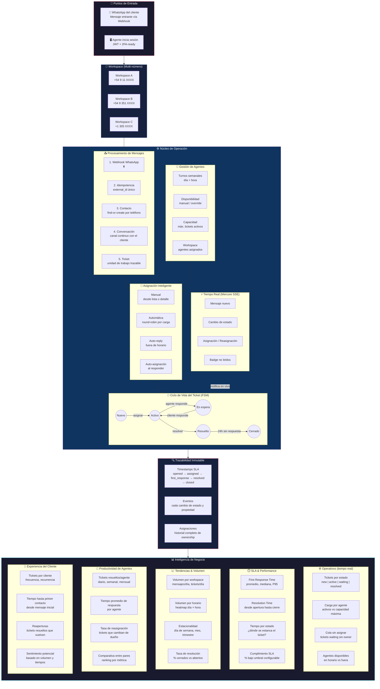

# Inbiox — Diagrama de Propuesta de Valor

> **Audiencia**: CEO / CTO / Decisor técnico
> **Objetivo**: Entender en 5 minutos cómo Inbiox profesionaliza la atención al cliente sobre WhatsApp.

---

## Flujo completo de la plataforma



---

## ¿Qué hace único a Inbiox?

| Concepto | Herramientas tradicionales | Inbiox |
|----------|---------------------------|--------|
| **Modelo de datos** | Conversación = Ticket (fusionados) | Conversación ≠ Ticket (separación estricta con FK constraint) |
| **Estados** | Status libre, sin reglas | FSM con 5 estados, 0 transiciones inválidas |
| **Auditoría** | Logs opcionales | Timestamps SLA inmutables + eventos secuenciales |
| **Tiempo real** | Polling o WebSocket básico | SSE seq-ordenado con detección de duplicados |
| **Multi-número** | Una instancia por número | Workspaces nativos con segregación completa |
| **Agentes** | Online/offline | Turnos semanales + capacidad + overrides con TTL |

---

## Capacidad de Reporting — El verdadero diferenciador

Toda la data existe en la base de datos desde la primera interacción.
**No se necesita ETL, no se necesita data warehouse, no se necesita un equipo de datos.**
Los timestamps SLA son inmutables por diseño de arquitectura: una vez que se registran, nadie puede alterarlos.

---

### 1. Dashboard Operativo (tiempo real)

Lo que un supervisor ve al abrir la pantalla.

#### 1.1 Tickets por estado

```sql
SELECT status, COUNT(*) AS total
FROM tickets
WHERE workspace_id = 1
GROUP BY status;
```

| Estado | Total |
|--------|-------|
| new | 12 |
| active | 47 |
| waiting | 83 |
| resolved | 1,204 |
| closed | 8,921 |

> 📊 **Lo que dice**: Hay 83 clientes esperando respuesta. El equipo está trabajando sobre 47 tickets activos. 12 tickets nuevos sin dueño necesitan asignación inmediata.

---

#### 1.2 Carga por agente (activos vs capacidad)

```sql
SELECT a.name,
       COUNT(t.id) AS active_tickets,
       a.max_active_tickets AS capacity,
       ROUND(COUNT(t.id) / a.max_active_tickets * 100, 1) AS load_pct
FROM agents a
LEFT JOIN tickets t ON t.assigned_agent_id = a.id AND t.status IN ('new', 'active', 'waiting')
WHERE a.active = 1
GROUP BY a.id
ORDER BY load_pct DESC;
```

| Agente | Activos | Capacidad | Carga % |
|--------|---------|-----------|---------|
| María López | 8 | 10 | 80.0 |
| Carlos Ruiz | 6 | 10 | 60.0 |
| Ana García | 5 | 10 | 50.0 |
| Juan Pérez | 3 | 10 | 30.0 |
| Laura Díaz | 0 | 10 | 0.0 |

> 📊 **Lo que dice**: María está al 80% — si entran 3 tickets más, se satura. Laura está libre. Hay que redistribuir o ajustar capacidades.

---

#### 1.3 Cola sin asignar

```sql
SELECT COUNT(*) AS unassigned,
       MIN(opened_at) AS oldest_waiting_since
FROM tickets
WHERE workspace_id = 1
  AND assigned_agent_id IS NULL
  AND status != 'closed';
```

| Sin asignar | El más antiguo espera desde |
|-------------|---------------------------|
| 12 | 2026-08-02 09:14:00 |

> 📊 **Lo que dice**: 12 clientes sin dueño. El más antiguo lleva esperando desde las 9:14 AM — ya son 3+ horas. Urgente asignar.

---

#### 1.4 Agentes disponibles ahora

```sql
SELECT a.name,
       s.day_of_week,
       s.start_time,
       s.end_time,
       a.is_available_override
FROM agents a
JOIN agent_shifts s ON s.agent_id = a.id
WHERE a.active = 1
  AND a.is_available = 1
  AND s.day_of_week = DAYOFWEEK(NOW())
  AND TIME(NOW()) BETWEEN s.start_time AND s.end_time;
```

| Agente | Día | Turno | Override |
|--------|-----|-------|----------|
| María López | Miércoles | 08:00 - 16:00 | — |
| Carlos Ruiz | Miércoles | 09:00 - 17:00 | — |
| Ana García | Miércoles | 14:00 - 22:00 | — |

> 📊 **Lo que dice**: Solo 3 de 5 agentes están en horario ahora. Laura y Juan entran más tarde. Ana recién empieza a las 14:00.

---

### 2. SLA & Performance

Métricas de velocidad de respuesta. Los timestamps son **inmutables**: no se pueden alterar ni "tocar" después de escritos. Esto hace que las métricas sean **auditables y no repudiables**.

#### 2.1 First Response Time (FRT) — por agente

```sql
SELECT a.name,
       COUNT(*) AS tickets,
       ROUND(AVG(TIMESTAMPDIFF(MINUTE, t.opened_at, t.first_response_at)), 1) AS avg_frt_min,
       MIN(TIMESTAMPDIFF(MINUTE, t.opened_at, t.first_response_at)) AS min_frt_min,
       MAX(TIMESTAMPDIFF(MINUTE, t.opened_at, t.first_response_at)) AS max_frt_min
FROM tickets t
JOIN assignments ass ON ass.ticket_id = t.id AND ass.sequence = 1
JOIN agents a ON a.id = ass.agent_id
WHERE t.workspace_id = 1
  AND t.first_response_at IS NOT NULL
  AND t.opened_at >= NOW() - INTERVAL 30 DAY
GROUP BY a.id
ORDER BY avg_frt_min;
```

| Agente | Tickets | FRT Promedio | Mínimo | Máximo |
|--------|---------|-------------|--------|--------|
| Ana García | 142 | 2.3 min | 0.1 min | 8.5 min |
| Carlos Ruiz | 98 | 3.1 min | 0.2 min | 12.0 min |
| María López | 187 | 4.7 min | 0.3 min | 23.1 min |
| Juan Pérez | 76 | 6.2 min | 0.5 min | 45.0 min |

> 📊 **Lo que dice**: Ana es la más rápida (2.3 min promedio). Juan tiene problemas — su máximo es 45 minutos. ¿Está sobrecargado? ¿Necesita capacitación?

---

#### 2.2 FRT — tendencia diaria (última semana)

```sql
SELECT DATE(opened_at) AS day,
       COUNT(*) AS tickets,
       ROUND(AVG(TIMESTAMPDIFF(MINUTE, opened_at, first_response_at)), 1) AS avg_frt_min
FROM tickets
WHERE workspace_id = 1
  AND first_response_at IS NOT NULL
  AND opened_at >= NOW() - INTERVAL 7 DAY
GROUP BY DATE(opened_at)
ORDER BY day;
```

| Día | Tickets | FRT Promedio |
|-----|---------|-------------|
| Lun 28/07 | 43 | 3.1 min |
| Mar 29/07 | 51 | 3.8 min |
| Mié 30/07 | 38 | 4.2 min |
| Jue 31/07 | 62 | 5.9 min |
| Vie 01/08 | 71 | 7.2 min |
| Sáb 02/08 | 22 | 2.1 min |
| Dom 03/08 | 8 | 1.8 min |

> 📊 **Lo que dice**: El FRT se degrada entre jueves y viernes (de 3.1 a 7.2 min). Los picos de volumen del jueves-viernes están saturando al equipo. Fin de semana tiene poco volumen pero respuesta rápida.

---

#### 2.3 Resolution Time — por estado previo

¿Cuánto tarda un ticket en resolverse según por dónde pasó?

```sql
SELECT COUNT(*) AS tickets,
       ROUND(AVG(TIMESTAMPDIFF(HOUR, opened_at, resolved_at)), 1) AS avg_hours_to_resolve,
       ROUND(AVG(COALESCE(TIMESTAMPDIFF(HOUR, assigned_at, resolved_at), 0)), 1) AS avg_active_hours
FROM tickets
WHERE workspace_id = 1
  AND status IN ('resolved', 'closed')
  AND resolved_at IS NOT NULL
  AND opened_at >= NOW() - INTERVAL 30 DAY;
```

| Tickets | Horas hasta resolver (prom) | Horas activas (prom) |
|---------|---------------------------|---------------------|
| 412 | 8.3 h | 2.1 h |

> 📊 **Lo que dice**: Un ticket tarda en promedio 8.3 horas en cerrarse, pero solo 2.1 horas son de trabajo activo. Las otras 6.2 horas el ticket está en estado "waiting" (esperando al cliente). Oportunidad: reducir el tiempo de espera con recordatorios automáticos.

---

### 3. Tendencias & Volumen

#### 3.1 Heatmap de volumen por día × hora

```sql
SELECT DAYOFWEEK(opened_at) AS dow,
       HOUR(opened_at) AS hour,
       COUNT(*) AS tickets
FROM tickets
WHERE workspace_id = 1
  AND opened_at >= NOW() - INTERVAL 90 DAY
GROUP BY dow, hour
ORDER BY dow, hour;
```

| Día | 08h | 09h | 10h | 11h | 12h | 13h | 14h | 15h | 16h | 17h | 18h | 19h |
|-----|-----|-----|-----|-----|-----|-----|-----|-----|-----|-----|-----|-----|
| **Lun** | 12 | 34 | 56 | 72 | 45 | 38 | 42 | 51 | 63 | 48 | 29 | 15 |
| **Mar** | 8 | 28 | 48 | 65 | 51 | 42 | 39 | 47 | 58 | 52 | 31 | 12 |
| **Mié** | 10 | 31 | 52 | 68 | 48 | 35 | 44 | 49 | 55 | 44 | 27 | 10 |
| **Jue** | 15 | 42 | 61 | 78 | 53 | 40 | 47 | 58 | 67 | 51 | 34 | 18 |
| **Vie** | 18 | 45 | 67 | 82 | 57 | 43 | 48 | 56 | 72 | 55 | 38 | 22 |
| **Sáb** | 3 | 8 | 15 | 22 | 18 | 14 | 12 | 10 | 8 | 5 | 2 | 1 |
| **Dom** | 1 | 2 | 4 | 6 | 5 | 3 | 3 | 2 | 2 | 1 | 1 | 0 |

> 📊 **Lo que dice**: El pico es jueves-viernes 10-11 AM y 16-17 PM. Necesitás más agentes en esas franjas. Sábado y domingo baja al 10% — se puede cubrir con auto-reply inteligente y un agente de guardia.

---

#### 3.2 Estacionalidad mensual

```sql
SELECT DATE_FORMAT(opened_at, '%Y-%m') AS month,
       COUNT(*) AS tickets,
       ROUND(AVG(TIMESTAMPDIFF(MINUTE, opened_at, first_response_at)), 1) AS avg_frt
FROM tickets
WHERE workspace_id = 1
  AND opened_at >= NOW() - INTERVAL 12 MONTH
GROUP BY month
ORDER BY month;
```

| Mes | Tickets | FRT Prom |
|-----|---------|----------|
| Sep 2025 | 1,203 | 3.8 min |
| Oct 2025 | 1,487 | 4.1 min |
| Nov 2025 | 1,892 | 5.3 min |
| Dic 2025 | 2,456 | 8.2 min |
| Ene 2026 | 3,102 | 6.7 min |
| Feb 2026 | 2,781 | 5.9 min |
| Mar 2026 | 2,340 | 5.1 min |
| Abr 2026 | 2,198 | 4.8 min |
| May 2026 | 2,567 | 5.2 min |
| Jun 2026 | 2,891 | 6.1 min |
| Jul 2026 | 3,245 | 7.4 min |
| Ago 2026 | 1,892 | 5.8 min |

> 📊 **Lo que dice**: Diciembre explota (+30% volumen, FRT se duplica). Hay que planificar refuerzos para noviembre-diciembre. El equipo crece con el volumen pero el FRT se degrada — se necesita automatización.

---

### 4. Productividad de Agentes

#### 4.1 Ranking de resolución

```sql
SELECT a.name,
       COUNT(*) AS resolved,
       ROUND(AVG(TIMESTAMPDIFF(MINUTE, t.opened_at, t.resolved_at)), 1) AS avg_resolution_min,
       ROUND(AVG(TIMESTAMPDIFF(MINUTE, t.opened_at, t.first_response_at)), 1) AS avg_frt_min
FROM tickets t
JOIN assignments ass ON ass.ticket_id = t.id
JOIN agents a ON a.id = ass.agent_id
WHERE t.workspace_id = 1
  AND t.status IN ('resolved', 'closed')
  AND t.resolved_at >= NOW() - INTERVAL 30 DAY
GROUP BY a.id
ORDER BY resolved DESC;
```

| Agente | Resueltos | Resolución (prom) | FRT (prom) |
|--------|-----------|-------------------|------------|
| María López | 87 | 6.2 min | 4.7 min |
| Ana García | 72 | 4.1 min | 2.3 min |
| Carlos Ruiz | 58 | 7.5 min | 3.1 min |
| Juan Pérez | 34 | 12.3 min | 6.2 min |
| Laura Díaz | 29 | 5.8 min | 3.4 min |

> 📊 **Lo que dice**: María resuelve más volumen pero Ana es más eficiente (4.1 min vs 6.2). Juan resuelve la mitad que María y tarda el doble — investigar.

---

#### 4.2 Tasa de reasignación

```sql
SELECT a.name,
       COUNT(*) AS total_assigned,
       SUM(CASE WHEN ass.type = 'reassign' THEN 1 ELSE 0 END) AS reassigned,
       ROUND(SUM(CASE WHEN ass.type = 'reassign' THEN 1 ELSE 0 END) / COUNT(*) * 100, 1) AS reassign_pct
FROM assignments ass
JOIN agents a ON a.id = ass.agent_id
WHERE ass.created_at >= NOW() - INTERVAL 30 DAY
GROUP BY a.id
ORDER BY reassign_pct DESC;
```

| Agente | Asignados | Reasignados | Tasa |
|--------|-----------|-------------|------|
| Juan Pérez | 45 | 12 | 26.7% |
| Laura Díaz | 38 | 5 | 13.2% |
| Carlos Ruiz | 62 | 6 | 9.7% |
| María López | 95 | 4 | 4.2% |
| Ana García | 78 | 2 | 2.6% |

> 📊 **Lo que dice**: 1 de cada 4 tickets de Juan termina reasignado. Hay un problema — ¿capacitación? ¿carga excesiva? ¿temas que no domina?

---

### 5. Experiencia del Cliente

#### 5.1 Clientes recurrentes (posible insatisfacción)

```sql
SELECT c.phone,
       c.name,
       COUNT(DISTINCT t.id) AS tickets_last_90d,
       ROUND(AVG(TIMESTAMPDIFF(HOUR, t.opened_at, t.resolved_at)), 1) AS avg_hours
FROM contacts c
JOIN tickets t ON t.contact_id = c.id
WHERE t.workspace_id = 1
  AND t.opened_at >= NOW() - INTERVAL 90 DAY
GROUP BY c.id
HAVING tickets_last_90d >= 3
ORDER BY tickets_last_90d DESC
LIMIT 10;
```

| Teléfono | Cliente | Tickets (90d) | Horas prom |
|----------|---------|---------------|-----------|
| +54 9 11 5555-0101 | Juan Rodríguez | 12 | 6.2 h |
| +54 9 11 5555-0102 | María Fernández | 9 | 3.1 h |
| +54 9 351 555-0103 | Carlos Gómez | 8 | 8.5 h |
| +54 9 11 5555-0104 | Ana Torres | 7 | 2.8 h |
| +54 9 11 5555-0105 | Laura Sánchez | 7 | 11.3 h |

> 📊 **Lo que dice**: Juan Rodríguez abrió 12 tickets en 3 meses — uno por semana. Laura Sánchez tiene un promedio de 11.3 horas por ticket. Ambos son candidatos a una revisión de cuenta: ¿se puede resolver su problema de raíz?

---

#### 5.2 Tickets reabiertos (resueltos que volvieron)

```sql
SELECT c.phone,
       t.id AS ticket_id,
       t.resolved_at,
       (SELECT MIN(m2.created_at) FROM messages m2
        WHERE m2.conversation_id = t.conversation_id
          AND m2.direction = 'inbound'
          AND m2.created_at > t.resolved_at) AS reopened_at,
       TIMESTAMPDIFF(HOUR, t.resolved_at,
         (SELECT MIN(m2.created_at) FROM messages m2
          WHERE m2.conversation_id = t.conversation_id
            AND m2.direction = 'inbound'
            AND m2.created_at > t.resolved_at)) AS hours_until_reopen
FROM tickets t
JOIN contacts c ON c.id = t.contact_id
WHERE t.workspace_id = 1
  AND t.status IN ('resolved', 'closed')
  AND t.resolved_at >= NOW() - INTERVAL 30 DAY
HAVING reopened_at IS NOT NULL
ORDER BY hours_until_reopen;
```

| Cliente | Ticket | Resuelto | Reabierto | Tardó |
|---------|--------|----------|-----------|-------|
| Carlos Gómez | #1423 | 01/08 14:30 | 01/08 16:45 | 2.2 h |
| Juan Rodríguez | #1412 | 31/07 10:00 | 31/07 15:30 | 5.5 h |
| Laura Sánchez | #1398 | 30/07 09:15 | 31/07 08:00 | 22.8 h |
| Ana Torres | #1405 | 30/07 16:00 | 01/08 09:00 | 41.0 h |

> 📊 **Lo que dice**: 4 reaperturas en 30 días. Carlos Gómez reabrió en solo 2 horas — el ticket se cerró sin resolver el problema real. Juan Rodríguez es recurrente. Estos son los tickets que destruyen el Net Promoter Score.

---

## Comparativa: Inbiox vs el resto en Reporting

| Capacidad | Zendesk / Intercom | Inbiox |
|-----------|-------------------|--------|
| Timestamps SLA | Editables o derivados | **Inmutables** — garantía de auditoría |
| Consultas ad-hoc | Limitadas al dashboard | **SQL directo** — cualquier pregunta, sin límites |
| Datos históricos | Retención limitada por plan | **Toda la data**, desde el día 1 |
| Segmentación | Filtros predefinidos | **WHERE, GROUP BY, HAVING** — libertad total |
| Exportación | CSV desde UI | **SQL → cualquier formato** (CSV, JSON, Excel, API) |
| Auditoría | "Confía en nosotros" | **Eventos inmutables + timestamps no editables** |

---

## Próximo paso

Agendar una demo técnica de 30 minutos donde recorremos el flujo completo en vivo,
incluyendo 3 consultas de reporting en tiempo real sobre datos reales.
