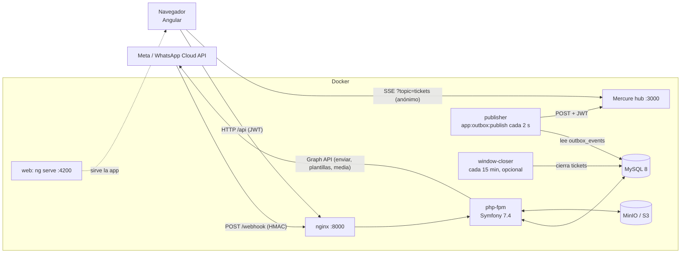
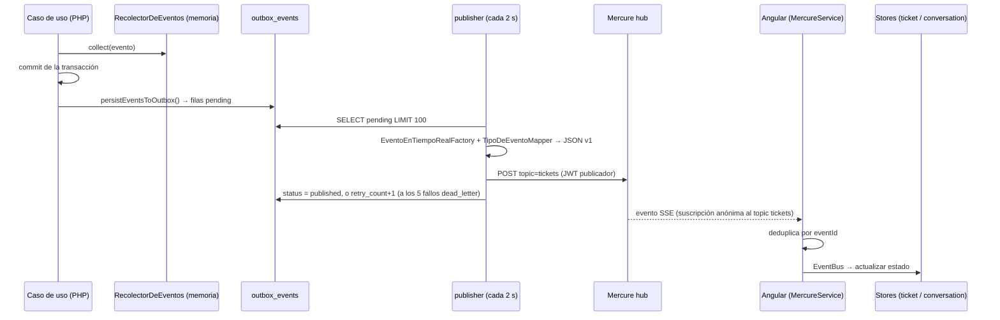

# 02 — Arquitectura y tecnologías

> Cómo está construido Inbiox hoy y por qué (cuando hay evidencia). Volver al [índice](README.md).
> Rutas del backend relativas a `apps/api/`; del frontend, a `apps/web/src/app/`.

## Vista general

**Idea clave:** la API nunca habla con Mercure dentro de una operación de negocio. Escribe eventos en la tabla `outbox_events` y un proceso separado (`publisher`) los envía a Mercure. El navegador escucha Mercure por SSE.

---

## Stack y justificación

"Justificación documentada" solo cita lo que está escrito en el repositorio. La especificación de producto (`docs/01_product/0-junstificacion-especificacion.md` §7) **lista** Symfony, Angular, MySQL, Mercure y AWS como elecciones, con las restricciones "presupuesto limitado, desarrollo incremental, evitar sobreingeniería, prioridad en MVP funcional" (§9), pero no explica por qué se eligió cada una frente a alternativas.

| Tecnología | Qué hace en Inbiox | Justificación documentada |
|---|---|---|
| PHP 8.3 + **Symfony 7.4** (`symfony/framework-bundle 7.4.*`) | API REST, seguridad, consola, inyección de dependencias. | Elegido en la especificación de producto (§7) y exigido en `docs/03_architecture/0-documento-tecnico.md` §14 ("usar Symfony, usar Doctrine ORM"). Motivo frente a alternativas: **Justificación no documentada.** |
| **Doctrine ORM 3** + Migrations | Mapeo de entidades (atributos PHP en `src/Domain`) y migraciones (`migrations/`). | Exigido en `0-documento-tecnico.md` §14. |
| **MySQL 8** | Base de datos. Se usan bloqueos `SELECT … FOR UPDATE` para concurrencia. | Elegido en la especificación de producto (§7). Motivo: **Justificación no documentada.** |
| **LexikJWTAuthenticationBundle** (RS256, 15 min) | Token de acceso. | **Justificación no documentada.** |
| **GesdinetJWTRefreshTokenBundle** (30 días, cookie `HttpOnly`, un solo uso) | Renovar la sesión sin exponer el refresh token a JavaScript. | **Justificación no documentada** (el diseño de cookie `HttpOnly` sugiere protección contra XSS, pero no está escrito). |
| **Mercure** (`dunglas/mercure`) + SSE | Tiempo real hacia el navegador. | Especificación de producto §7 ("Mercure / WebSockets") y `0-documento-tecnico.md` §13. |
| **Patrón outbox transaccional** | Garantizar que un evento no se pierda si la operación se confirma. | `docs/04_sprints/sprint_9B (Realtime con Mercure).md`: "Outbox pattern is MANDATORY (no direct publish)", "Outbox INSERT MUST be in SAME transaction", objetivo "No lost events". **Hoy no se cumple del todo**: ver [problemas del pipeline](#problemas-conocidos-del-pipeline). |
| `lcobucci/jwt` | Firmar/verificar los JWT de Mercure (HS256). | **Justificación no documentada.** |
| `symfony/http-client` | Cliente HTTP de `GraphClient` (WhatsApp). Hasta la fase 1 llegaba solo como dependencia de `symfony/mercure-bundle` (sin uso, se borró); ahora está declarado. | — |
| **Angular 21** (standalone + signals), RxJS 7.8, Angular CDK (scroll virtual) | Aplicación web. | Especificación de producto §7. Uso de signals y CDK: **Justificación no documentada.** |
| **WhatsApp Cloud API** (Graph API v25.0) | Canal de mensajería. | Producto: "atención principalmente sobre WhatsApp" (`retomar-proyecto-inbiox.md`). |
| **S3 / MinIO** (`aws/aws-sdk-php`) | Guardar adjuntos y servirlos con URL prefirmada. | Especificación de producto §7: "AWS (objetivo)". MinIO como sustituto local: **Justificación no documentada.** |
| `league/csv` | Export CSV en streaming con protección anti CSV-injection. | Spec `openspec/specs/reports-export`. |
| **Docker Compose** + nginx | Entorno local. No hay manifiestos de producción en el repo. | **Justificación no documentada.** |
| Redis, MailHog | Se borraron de `docker-compose.yml` en la fase 1 porque la app no los usaba. Quedan **previstos**: Redis para cache y un mailer para enviar mails; se agregan cuando haya un caso de uso real. | — |
| PHPUnit 11 / Karma + Jasmine | Tests backend / frontend. | — |
| Contenedor/presentacional, casos de uso, stores (frontend) | Organización del código Angular. | Comentarios en el código (p. ej. `features/inbox/components/ticket-participation/ticket-participation.component.ts:6-14`). Aplicado de forma parcial. |
| "Bounded contexts" y WhatsApp como adaptador de canal | Mantener el motor (asignación, capacidad, disponibilidad) independiente de WhatsApp. | `docs/03_architecture/ADR-004-platform-ready-bounded-contexts.md` (Accepted, 2026-08-11). Parcialmente aplicado (ver [violaciones](#separación-de-responsabilidades-reglas-del-proyecto-y-dónde-se-violan-hoy)). |

---

## Backend: capas y carpetas

Todo en `apps/api/src/`, organizado **por módulo de negocio** desde la fase 2 de la limpieza (estructura objetivo y reglas en [`docs/arquitectura.md`](../arquitectura.md)). Los nombres de clase todavía están en inglés; se traducen en la fase 5.

| Módulo | Contiene | Ejemplos |
|---|---|---|
| `Ticket/` | Ticket, estados, máquina de estados, etiquetas, bandeja. | `Ticket.php`, `MaquinaDeEstadosDeTicket.php`, `Controller/BandejaController`, `Controller/FlujoDeTicketController`, `Query/ListTicketsQuery`, `Query/FiltrosDeTicketBuilder` |
| `Conversacion/` | Conversación, mensajes, media, ventana de 24 h, webhook de Meta, envío. | `Controller/WebhookController`, `Controller/ProxyDeProveedorController`, `UseCase/ProcesarMensajeEntranteUseCase`, `UseCase/ProcesarPayloadWebhookUseCase`, `UseCase/EnviarMensajeSalienteUseCase`, `UseCase/EnviarPlantillaUseCase`, `UseCase/SubirAdjuntoUseCase`, `PoliticaDeVentana.php`, `ValidadorDeAdjunto.php` |
| `Contacto/` | Contactos, importación, línea de tiempo. | `Controller/ContactoController`, `Query/GetLineaDeTiempoDeContactoQuery`, `UseCase/ImportarContactosDesdeCsvUseCase` |
| `Agente/` | Agentes, equipos, perfil propio (`/api/me`). | `Agente.php`, `Equipo.php`, `Controller/MiConfiguracionController` (configuración, perfil y notificaciones; auto-respuesta, turnos y workspaces propios viven en Automatizacion, Disponibilidad y Administracion) |
| `Disponibilidad/` | Turnos, disponibilidad manual. | `Turno.php`, `DisponibilidadDeAgenteService.php`, `UseCase/SetDisponibilidadManualUseCase` |
| `Asignacion/` | Asignación manual y automática. | `ResponsabilidadDeTicketService.php`, `UseCase/AsignarTicketUseCase`, `UseCase/AsignarTicketAutomaticamenteUseCase`, `EventListener/AsignacionAutomaticaSolicitadaListener` |
| `Reporte/` | Métricas y exportación. | `Controller/ReporteController`, `Query/ReporteService`, `Repository/ReporteRepository` |
| `Automatizacion/` | Reglas y respuesta automática. | `EjecutorDeReglas.php`, `ReglaDeReaperturaAutomatica.php`, `ReglaDeEtiquetadoPorPalabraClave.php`, `RespuestaAutomaticaService.php`, `DependencyInjection/ReglaPass` (registra **a mano** las reglas) |
| `Administracion/` | Espacios de trabajo, usuarios y el ABM de administración (`/api/admin/*`). | `Usuario.php`, `EspacioDeTrabajo.php`, `Controller/GestionDeUsuariosController`, `Controller/GestionDeAgentesController`, `UseCase/` (un caso de uso por cada escritura de administración) |
| `Autenticacion/` | Login, refresh token, chequeo de usuarios inactivos. | `Controller/AutenticacionController`, `Security/VerificadorDeUsuario`, `RefreshToken.php` |
| `Compartido/` | Outbox, tiempo real, cliente de Graph, storage, scopes de seguridad, excepciones comunes. | `Outbox/OutboxPublisherService`, `Realtime/EventoEnTiempoRealFactory`, `Graph/GraphClient`, `Storage/AdjuntoStorageService`, `Security/AlcanceDeResponsabilidad` |

Dentro de cada módulo, las carpetas de capa son `Controller/`, `UseCase/`, `Query/`, `Repository/` y, cuando hacen falta, `Command/`, `EventListener/` y `Security/` (voters). Las entidades Doctrine y las reglas puras van en la raíz del módulo; Doctrine mapea todo `src/` (`config/packages/doctrine.yaml`). **La fase 2 solo movió clases:** las violaciones de capa (controladores con lógica, SQL fuera de repositorios) siguen y se corrigen en la fase 3.

### Cómo encontrar el código de un request (receta)

1. Buscar el path con `php bin/console debug:router --show-controllers` o con `rg "#\[Route\('/api/…"` → da el controlador.
2. Ver permisos: `config/packages/security.yaml` (`access_control`, la primera regla que coincide) + `#[IsGranted]` de clase + `#[IsGranted]` de método + voters dentro de la acción. **Todas** deben pasar.
3. Seguir la llamada al caso de uso o consulta del módulo (`<Modulo>/UseCase/`, `<Modulo>/Query/`).
4. Ante un 500 con `reference`, buscar ese valor en los logs (`Unhandled exception …`). Desde la fase 3b, todo 500 inesperado de `/api` lo arma un único listener, `Compartido/EventListener/InternalServerErrorListener`. Los errores específicos (400, 404, 409, 422…) siguen en cada controlador hasta la fase 5.

### Ruteo: los atributos `#[Route]` son la única fuente

- Desde la fase 2, cada acción declara su ruta con `#[Route]` y `config/routes.yaml` solo tiene `resource: routing.controllers`. Las **90 rutas** se regeneraron a partir del YAML anterior: `debug:router` da el mismo conjunto con el mismo contenido (cambia solo el orden del listado) y cada URL sigue resolviendo a la misma ruta.
- Antes de la fase 2, el YAML era la única fuente y los atributos estaban muertos: por eso `TagController` y `AutoCloseController`, que solo tenían atributos, eran inalcanzables (se borraron en la fase 1).
- `src/Kernel.php` define un método `configure()` que `MicroKernelTrait` nunca llama (código muerto, propósito no confirmado).

## Frontend: capas y carpetas

Todo en `apps/web/src/app/`. Detalle por pantalla en [07-frontend.md](07-frontend.md).

| Carpeta | Contiene | Observación |
|---|---|---|
| `app.config.ts`, `app.routes.ts` | Arranque, rutas, interceptor, proveedor WhatsApp. | |
| `core/api/` | 11 servicios HTTP (`*-api.service.ts`). | Capa de transporte. |
| `core/application/` | Casos de uso (admin, mensajería, reportes, contactos). | No hay casos de uso para la bandeja, settings ni workspace. |
| `core/stores/` | Estado compartido con signals (`auth`, `ticket`, `conversation`, `connection`, `ui`, `workspace`, `settings`, `agent`, `theme`). | Varios stores hacen HTTP directamente. |
| `core/realtime/` | `MercureService` (SSE por `fetch`), `EventBusService`. | |
| `core/providers/` | `ProviderInterface`, `WhatsAppCloudProvider` (proxy a `/api/provider/*`), `FakeWhatsAppProvider` (sin uso). | La "abstracción de proveedor" de ADR-004 existe **solo** aquí. |
| `core/dto/`, `core/models/`, `core/utils/`, `core/auth/`, `core/services/` | DTOs compartidos, modelos canónicos, utilidades, guards/interceptor, `agent.service.ts` (roto). | |
| `features/` | `inbox`, `contacts` (con su propia mini-arquitectura), `reports`, `admin/*`, `agents/*`, `settings`, `login`. | |
| `shell/` | Layout: barra superior, menú lateral, selector de workspace, banner de conexión. **El shell pinta directamente la bandeja.** | |
| `shared/` | Componentes, pipes y validadores reutilizables. | |
| `domain/`, `dto/` (raíz) | **Código muerto** (nada los importa). | |

---

## Autenticación y autorización

| Pieza | Dónde | Comportamiento |
|---|---|---|
| Firewalls | `config/packages/security.yaml:15-42` | `webhook` (`^/webhook`, sin seguridad: se valida HMAC en el controlador) y `api` (todo lo demás, stateless). |
| Login | `json_login` en `/api/auth/login` | No llega al controlador. Devuelve `{access_token, token_type, expires_in: 900}` + cookie `inbiox_refresh`. `RespuestaDeAutenticacionListener` renombra `token` → `access_token`. |
| Refresh | `refresh_jwt` en `/api/auth/refresh` | Lee la cookie, rota el refresh token (un solo uso). |
| Logout | `AutenticacionController::cerrarSesion` | Borra **todos** los refresh tokens del usuario. El access token sigue válido hasta 15 min (no hay lista negra). |
| Rate limit de login | `security.yaml:40-42` | 5 intentos/minuto; estado en filesystem (por eso hay que limpiarlo antes de correr tests). |
| Usuarios inactivos | `src/Autenticacion/Security/VerificadorDeUsuario.php` | Los rechaza en `checkPostAuth()`, también con JWT. |
| Jerarquía de roles | `security.yaml:2-4` | `ROLE_ADMIN` ⊃ `ROLE_SUPERVISOR` ⊃ `ROLE_AGENT`. En el frontend los roles **no** son jerárquicos (se compensa en `roleGuard`). |
| Voters | `Ticket/Security/TicketVoter.php` (usado: `ASSIGN`, `CLOSE`), `src/Conversacion/Security/MensajeVoter.php` (solo URL de adjuntos) | Ver [06](06-api-y-permisos.md). |
| Scopes | `AlcanceDeResponsabilidad` (siempre `null`: bandeja compartida, decisión Sprint 16) y `AlcanceDeEspacioDeTrabajo` (filtra por el `phone_number_id` del workspace activo; si no hay, **no filtra**) | El primero se reutiliza mal como autorización ([R3](00-estado-y-pendientes.md#r3-cualquier-agente-modifica-disponibilidad-y-turnos-de-cualquier-agente)). |
| Usuario ↔ Agente | `Agente.usuario` (1:1 opcional) | Si un usuario sin agente envía un mensaje o cambia de workspace (admin/supervisor), **se le crea un agente** con nombre = email (`Agente/UseCase/AsegurarAgenteDeUsuarioUseCase.php`, `Administracion/UseCase/SetEspacioDeTrabajoActivoUseCase.php` (`ensureAgent`)). |

---

## Tiempo real: outbox → publicador → Mercure → SSE

| Paso | Archivos |
|---|---|
| Recolección de eventos | `Compartido/DomainEvent.php`, `Compartido/RecolectorDeEventos.php` |
| Escritura en outbox | Un solo escritor: `Compartido/Outbox/OutboxWriter::write()` (persist + flush, siempre después del commit del negocio). Cada caso de uso sigue armando **su propio payload** en `persistEventsToOutbox()`: `ProcesarMensajeEntranteUseCase.php:109-157`, `ProcesarMensajeSalienteUseCase.php:371-428`, `AsignarTicketUseCase.php:145-184`, `AsignarTicketAutomaticamenteUseCase.php:211-249`, `ProcesarActualizacionDeEstadoUseCase.php:216-257`. Disponibilidad, turnos y `MarcarTicketLeidoUseCase` arman un `EventoOutbox` y lo pasan al mismo escritor. |
| Publicación | `Compartido/Command/OutboxPublishCommand.php` → `Compartido/Outbox/OutboxPublisherService.php` |
| Contrato | `Compartido/Realtime/EventoEnTiempoRealFactory.php`, `TipoDeEventoMapper.php`, `TipoDeEventoEnTiempoReal.php` (`ticket.created`, `ticket.status_changed`, `ticket.assigned`, `message.added`, `message.updated`, `conversation.updated`, `agent.availability_changed`, `agent.shift_changed`) |
| Token de suscripción | `GET /api/mercure/token` → `MercureJwtService::issueParaUsuario()`; en la práctica el frontend **no lo usa para suscribirse** (el hub es anónimo), solo para el resync. |
| Frontend | `core/realtime/mercure.service.ts`, `core/realtime/event-bus.service.ts`, `core/stores/ticket.store.ts:112-208`, `core/stores/conversation.store.ts:65-107` |

### Problemas conocidos del pipeline

Deducidos de la lectura; confirmar con `SELECT event_type, status, COUNT(*) FROM outbox_events GROUP BY 1,2` en un entorno real.

| # | Problema | Evidencia |
|---|---|---|
| P-1 | `InboxUpdatedEvent` no está en `TipoDeEventoMapper` → falla 5 veces → `dead_letter`. | `TipoDeEventoMapper.php:11-19`; `OutboxPublisherService.php:206-210` |
| P-2 | `outbox_events.sequence` queda en 0 salvo en estados de entrega → el resync por `afterSequence` no devuelve casi nada. | `ProcesarActualizacionDeEstadoUseCase.php:245`; `EventoOutboxRepository::findFilasParaResincronizar` |
| P-3 | El resync filtra por `aggregate_id` sin `aggregate_type` (mezcla eventos de agente y de ticket). Además es inalcanzable (401 del firewall). | `EventoOutboxRepository::findFilasParaResincronizar` |
| P-4 | En el mensaje entrante, la auto-asignación se publica como `ticket.status_changed` vacío, no como `ticket.assigned`. | `ProcesarMensajeEntranteUseCase.php:124-142` |
| P-5 | Resolver, cerrar, transicionar y el cierre por ventana **no escriben nada** en el outbox. | `CambiarEstadoDeTicketUseCase.php` (no tiene `RecolectorDeEventos`) |
| P-6 | `ConversationUpdatedEvent` existía en el contrato sin que nadie lo emitiera; se borró en la fase 1 (el frontend todavía declara `conversation.updated`). (`ticket.read` sí se emite: lo inserta `BandejaController::marcarLeido` por SQL con el tipo ya en formato de contrato, que `EventoEnTiempoRealFactory::resolveEnum()` acepta.) | `BandejaController.php:189-202`; `EventoEnTiempoRealFactory.php:42-53` |
| P-7 | Plantillas y reaperturas por ventana no emiten eventos (la segunda es una limitación aceptada y documentada en `ProcesarMensajeEntranteUseCase.php:342-350`). | — |
| P-8 | Topics `agent/{id}/availability`, `agent/{id}/shifts`, `agents`: se publican o conceden, pero el frontend no los escucha. | `MercureJwtService.php:28-32` |
| P-9 | El publicador lee el outbox sin bloqueo de filas: si corren dos a la vez (por ejemplo el servicio docker `publisher` y `POST /admin/outbox/publish`), se duplican eventos (el frontend deduplica por `eventId`). La unidad systemd alternativa se borró en la fase 1; el publicador solo corre en docker. | `OutboxPublisherService.php:65-78` |
| P-10 | Frontend: la detección de huecos está desactivada, `resyncAllTickets()` nunca se llama, si el stream cierra limpio no reconecta, tras 10 fallos deja de reintentar y el menú lateral sigue diciendo "Conectado". | `mercure.service.ts:110-113, 282-286, 403-424` |
| P-11 | Seguridad: hub anónimo, eventos públicos, topic único ([R4](00-estado-y-pendientes.md#r4-tiempo-real-sin-aislamiento-entre-workspaces)). El secreto JWT efectivo sale de `config/packages/test.yaml`, cargado en todos los entornos; `MERCURE_URL`, `MERCURE_PUBLIC_URL` y `MERCURE_JWT_SECRET` del `.env` no tienen efecto real (la URL del hub está fija en el constructor de `OutboxPublisherService`). | `OutboxPublisherService.php:27`; `MercureJwtService.php:198-201` |

---

## Procesos en segundo plano

| Comando | Qué hace | Cómo corre |
|---|---|---|
| `app:outbox:publish` | Publica eventos pendientes en Mercure. No tiene opciones (`--status`, que se ignoraba, se borró en la fase 1). | Servicio docker `publisher`, bucle cada 2 s, `restart: always`. Alternativa manual: `POST /admin/outbox/publish` (admin). |
| `app:outbox:dead-letter` | `list`, `retry <id>`, `purge [días]` de eventos fallidos. | Manual. |
| `app:conversation-window:close-expired` | Cierra tickets con la ventana de 24 h vencida. Opciones `--dry-run`, `--limit=200`, `--safety-margin`. | Servicio docker `window-closer` (**profile opcional**), cada 900 s. El comentario del compose pide revisar antes con `--dry-run`. |
| `app:seed-users` | Crea 2 admins, 2 supervisores y 6 agentes (`@inbiox.local`) repartidos en los dos primeros workspaces. Contraseña fija en `src/Administracion/Command/SeedUsuariosCommand.php:31`. | Manual (dev). Requiere workspaces existentes. |
| `app:seed-reports` | Trunca y siembra datos para tests de reportes. Protegido (`APP_ENV=test` y base `inbiox_test`). | Lo usan los tests. |

No hay cron ni Symfony Scheduler. El `Makefile` tiene un target `seed` que llama a `app:seed`, **que no existe**.

## Servicios de docker-compose

| Servicio | Contenedor | Puerto host | Rol | Notas |
|---|---|---|---|---|
| `php` | `inbiox_php` | — | API Symfony (PHP 8.3-fpm) | Lee `apps/api/.env` y `.env.dev`. |
| `nginx` | `inbiox_nginx` | 8000 | Entrada HTTP de la API; proxy de `/.well-known/mercure` | `client_max_body_size 100M`. |
| `db` | `inbiox_db` | (no publicado) | MySQL 8 | Credenciales literales en el compose. |
| `mercure` | `inbiox_mercure` | 3000 | Hub SSE | `anonymous`, CORS `localhost:4200`. |
| `publisher` | `inbiox_publisher` | — | Bucle `app:outbox:publish` | |
| `window-closer` | `inbiox_window_closer` | — | Bucle de cierre por ventana | `profiles: [window-closer]`: solo con `--profile window-closer`. |
| `web` | `inbiox_web` | 4200 | `ng serve` con `proxy.conf.docker.json` | |
| `minio` / `minio-init` | `inbiox_minio` | 9000, 9001 | S3 local y creación del bucket privado `inbiox-media` | Credenciales literales. |
| `adminer` | `inbiox_adminer` | 8080 | UI de base de datos | Dev. |

`infra/` solo tiene el `Dockerfile` de PHP, `uploads.ini` y la config de nginx. **No se sabe cómo se despliega a producción.**

## Integraciones externas

| Integración | Cliente | Detalles |
|---|---|---|
| WhatsApp Cloud API (Meta) | `src/Compartido/Graph/GraphClient.php` (clase concreta, sin interfaz) | Base `https://graph.facebook.com/v25.0` (el docblock dice v23.0). Métodos: `sendMessage`, `sendMediaMessage`, `sendTemplate`, `uploadMedia` (siempre con el `phone_number_id` por defecto del env), `downloadMedia`. **Un solo access token para todos los workspaces**: funciona solo si todos los números están en la misma app/WABA de Meta. Contiene un workaround temporal hardcodeado (`WS2_TEST_PHONE_NUMBER_ID`, `normalizePhone()`) que quita el `9` de móviles argentinos solo para un número de prueba. Lo llaman `ProxyDeProveedorController` (solo `downloadMedia`), `EnviarMensajeSalienteUseCase`, `EnviarPlantillaUseCase`, `SubirAdjuntoUseCase`, `RespuestaAutomaticaService` y `Conversacion/DescargaDeAdjuntoService`. |
| Webhook de Meta | `src/Conversacion/Controller/WebhookController.php` | GET: verificación (`META_WEBHOOK_VERIFY_TOKEN`). POST: HMAC SHA-256 con `META_APP_SECRET`; guarda el payload crudo en `webhook_payloads`; pasa el payload a `UseCase/ProcesarPayloadWebhookUseCase`; siempre responde 200. Un solo app secret para todos los números. |
| S3 / MinIO | `config/services.yaml:46-68`, `Compartido/Storage/*` | Dos clientes (interno y público para URLs prefirmadas), bucket `S3_BUCKET`, clave `default/{messageId}/…` (tenant `default` fijo). |
| Mercure | ver [tiempo real](#tiempo-real-outbox--publicador--mercure--sse) | |

## Variables de entorno (solo nombres)

Archivos: `apps/api/.env` (no versionado), `.env.dev` (**versionado, con credenciales reales: ver [R1](00-estado-y-pendientes.md#r1-credenciales-de-meta-versionadas)**), `.env.test` (versionado), `.env.example` (versionado, **incompleto**).

| Variable | Uso | ¿Tiene efecto real? |
|---|---|---|
| `APP_SECRET`, `APP_ENV`, `DEFAULT_URI`, `CORS_ALLOW_ORIGIN`, `DATABASE_URL` | Framework | Sí (`APP_ENV` no está definida: el default es `dev`). |
| `JWT_SECRET_KEY`, `JWT_PUBLIC_KEY`, `JWT_PASSPHRASE` | Claves RS256 de Lexik (`config/jwt/*.pem`, no versionadas) | Sí. |
| `REFRESH_COOKIE_SECURE` | Flag `secure` de la cookie de refresh | Sí. |
| `MERCURE_URL`, `MERCURE_PUBLIC_URL`, `MERCURE_JWT_SECRET` | Las leía MercureBundle, borrado en la fase 1 (Flex sacó su bloque de `apps/api/.env`; puede quedar en otros `.env*`). | **No se usan.** El secreto real es el parámetro de `config/packages/test.yaml`. |
| `META_ACCESS_TOKEN`, `META_PHONE_NUMBER_ID`, `META_APP_SECRET`, `META_WEBHOOK_VERIFY_TOKEN` | WhatsApp | Sí. |
| `S3_ENDPOINT`, `S3_PUBLIC_ENDPOINT`, `S3_REGION`, `S3_KEY`, `S3_SECRET`, `S3_BUCKET`, `MEDIA_URL_TTL` | Media | Sí. |
| `CONVERSATION_WINDOW_SAFETY_MARGIN_MINUTES` | Margen de la ventana de 24 h (5 min) | Sí. |
| `INITIAL_ADMIN_PASSWORD` | Contraseña del admin `admin@inbiox.local` sembrado por la migración base (`Version20261017210004`) | Sí. **Obligatoria para migrar desde cero.** |
| `TEST_TOKEN` | Sufijo de base en tests paralelos | Opcional. |

## Migraciones

- Una sola migración en `apps/api/migrations/`: la base `Version20261017210004`, generada desde el mapping de Doctrine en la fase 5-1 de la limpieza. Reemplazó a las 28 anteriores, que ya no aplicaban sobre una base vacía (`Version20260616000001` fallaba con "Illegal mix of collations" porque `agents` quedaba con el collation por defecto del servidor y `user` con `utf8mb4_unicode_ci`).
- Las tablas se crean con `utf8mb4_unicode_ci`, fijado en `config/packages/doctrine.yaml` (`default_table_options`), el mismo collation que tenían las bases existentes.
- Migrar desde cero exige `INITIAL_ADMIN_PASSWORD`: la migración base siembra `admin@inbiox.local` y, si hay `META_PHONE_NUMBER_ID`, el workspace "Default" (los mismos seeds que hacían `Version20260616000001` y `Version20260728161023`). Posible bug heredado: `getenv()` devuelve `false` (no `null`) si falta la variable, y la guarda lo deja pasar. `app:seed-users` necesita ese workspace.
- El mapping de Doctrine declara los índices y la FK `tickets.team_id` (`ON DELETE SET NULL`), todas las columnas tienen nombre explícito y `doctrine:schema:validate` da mapeo y base en sync sobre una base creada con la migración base.
- Las bases creadas con la cadena vieja (la de desarrollo local) tienen registrada la migración base con `doctrine:migrations:version --add --all`. En ellas `doctrine:schema:update --dump-sql` solo propone diferencias cosméticas: comentarios `DC2Type` en `teams` y `tickets.last_read_at`, y los nombres de los índices automáticos de `agent_team`.

---

## Separación de responsabilidades: reglas del proyecto y dónde se violan hoy

> Esta sección documenta el estado actual para una **decisión futura**. No es un plan de refactorización ni una recomendación de reescribir.

### Reglas que el proyecto se dio (evidencia escrita)

| Regla | Fuente |
|---|---|
| "Respetar separación por capas", "generar código limpio y modular", "no crear lógica duplicada". | `docs/03_architecture/0-documento-tecnico.md` §14-15 |
| El dominio (Ticket, Assignment, Capacity, Availability, FSM) no conoce WhatsApp; el canal se usa a través de un puerto (interfaz). | `ADR-004` §1-3 |
| Los casos de uso no llaman a Mercure; la lógica del outbox está aislada; el evento se inserta en la misma transacción. | `docs/04_sprints/sprint_9B (Realtime con Mercure).md` |
| Frontend: "inbox never talks to core/api/ directly"; "core/api/ services should not import from features/". | Comentarios en `ticket-participation.component.ts:6-14` y `core/dto/reports.params.ts:5` |
| Implícita por la estructura de carpetas: Controller → Application (UseCase/Query/Service) → Domain; Repository/Infrastructure implementan interfaces del dominio. | Estructura de `src/` |

### Dónde se violan hoy — backend

| # | Violación | Evidencia | Efecto observado |
|---|---|---|---|
| B1 | Controladores con lógica de negocio, SQL o `EntityManager` directo. | `ProxyDeProveedorController` orquestaba el envío (resolvía el teléfono y llamaba a Graph); resuelto en la fase 4a. | La regla queda repartida; es difícil saber "dónde está" una operación. Fase 3d: ningún controlador usa `EntityManager` ni SQL y toda escritura pasa por un caso de uso; partir el flujo de envío queda para la fase 4. Fase 4a-2: el envío de texto y media (`send`) pasó a `EnviarMensajeSalienteUseCase`; 4a-3: las plantillas pasaron a `EnviarPlantillaUseCase`, y ambos resuelven el teléfono con `Ticket::telefonoDestinatario()`. 4a-4: la subida de media pasó a `SubirAdjuntoUseCase`; el controlador solo conserva la descarga como proxy a Graph. |
| B2 | El dominio depende de aplicación e infraestructura. | `Automatizacion/ReglaDeReaperturaAutomatica.php:12-13` usa `CambiarEstadoDeTicketUseCase` y el `EntityManager`. | Dirección de dependencias invertida. |
| B3 | Implementación concreta dentro de `Domain`. | `Disponibilidad/Repository/TurnoRepository.php` | Inconsistencia con `Repository/`. |
| B4 | ~~Interfaces con una sola implementación.~~ **Resuelto en la fase 2.** | Se borraron 8 interfaces (7 de repositorio y `RecolectorDeEventos`); se inyecta la clase concreta. | — |
| B5 | WhatsApp no está detrás de un puerto (contradice ADR-004). | `GraphClient` concreto inyectado en un controlador y en dos servicios. | Cambiar de proveedor implica tocar varios lugares. |
| B6 | Lógica de outbox duplicada dentro de cada caso de uso (5 copias con formatos distintos, topics fijos). | ver [tiempo real](#tiempo-real-outbox--publicador--mercure--sse) | Causa directa de P-1, P-2, P-4. |
| B7 | Un "scope" de reportes se reutiliza como autorización. | `DisponibilidadDeAgenteController::isPermitidoParaAgente()` usa `AlcanceDeResponsabilidad`. | Hallazgo de seguridad [R3](00-estado-y-pendientes.md#r3-cualquier-agente-modifica-disponibilidad-y-turnos-de-cualquier-agente). |
| B8 | Regla de negocio duplicada en el controlador. | `DisponibilidadDeAgenteController::isAgenteEnTurno()` copia la lógica de turnos del servicio (y no mira `active`). | Dos definiciones que pueden divergir. |
| B9 | Un evento + listener funciona como llamada directa en la misma transacción. | `TicketRequiereAsignacionAutomaticaEvent` → `AsignacionAutomaticaSolicitadaListener::executeInTransaction`. | Parece desacoplado pero no lo está ([R9](00-estado-y-pendientes.md#r9-la-auto-asignación-puede-hacer-perder-mensajes-entrantes)). |
| B10 | Una entidad del agregado Ticket se usa para cosas que no son de ticket. | `Compartido/EventoProcesado.php` guarda idempotencia de mensajes salientes y el límite de auto-respuestas. | Nombre engañoso. |
| B11 | Un voter mezcla autorización con validación de estado. | `TicketVoter` lanza `ConflictoDeEstadoException` (409) dentro de `voteOnAttribute`. | Comportamiento inesperado si se usa `isGranted` en otro contexto. |

### Dónde se violan hoy — frontend

| # | Violación | Evidencia |
|---|---|---|
| W1 | El núcleo de la bandeja no usa casos de uso: los contenedores llaman a `core/api` o a `HttpClient` y escriben en los stores. | `ticket-list.component.ts:51-53`, `conversation.component.ts:89,200`, `shell/app-shell.component.ts:60-61` |
| W2 | Stores que hacen HTTP. | `settings.store.ts`, `workspace.store.ts`, `auth.store.ts`, `agent.store.ts`, `features/contacts/stores/contact-timeline.store.ts` |
| W3 | `core` importa de `features` (al revés de la regla escrita). | `core/application/reports/get-reports-dashboard.use-case.ts:7-16` importa `features/reports/models` |
| W4 | Componente presentacional con acceso a API. | `TeamFilterComponent` llama `TeamApiService` |
| W5 | Reglas de negocio duplicadas en el navegador. | ventana de 24 h, FSM, `new → active` al asignar, permisos de asignación (ver [07](07-frontend.md#lógica-de-negocio-que-vive-en-el-frontend)) |
| W6 | DTOs en tres lugares y carpetas muertas. | `app/dto/`, `app/domain/` (muertas), `core/dto/` y `features/contacts/models/dto/` (duplicado de contacto) |
| W7 | Flujo "abrir ticket y cargar mensajes" escrito tres veces. | `ticket-list.component.ts:176-192`, `app-shell.component.ts:96-112`, `inbox-page.component.ts:30-67` (este último nunca se renderiza) |
