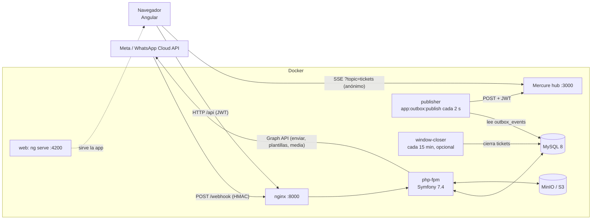
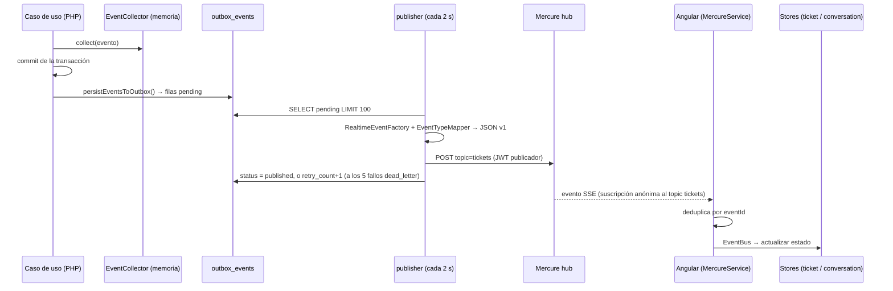

# 02 — Arquitectura y tecnologías

> Cómo está construido Inbiox hoy y por qué (cuando hay evidencia). Volver al [índice](README.md).
> Rutas del backend relativas a `apps/api/`; del frontend, a `apps/web/src/app/`.

## Vista general

**Idea clave:** la API nunca habla con Mercure dentro de una operación de negocio. Escribe eventos en la tabla `outbox_events` y un proceso separado (`publisher`) los envía a Mercure. El navegador escucha Mercure por SSE.

---

## Stack y justificación

"Justificación documentada" solo cita lo que está escrito en el repositorio. La especificación de producto (`docs/01_product/0-junstificacion-especificacion.md` §7) **lista** Symfony, Angular, MySQL, Mercure y AWS como elecciones, con las restricciones "presupuesto limitado, desarrollo incremental, evitar sobreingeniería, prioridad en MVP funcional" (§9), pero no explica por qué se eligió cada una frente a alternativas.

| Tecnología | Qué hace en Inbiox | Justificación documentada |
|---|---|---|
| PHP 8.3 + **Symfony 7.4** (`symfony/framework-bundle 7.4.*`) | API REST, seguridad, consola, inyección de dependencias. | Elegido en la especificación de producto (§7) y exigido en `docs/03_architecture/0-documento-tecnico.md` §14 ("usar Symfony, usar Doctrine ORM"). Motivo frente a alternativas: **Justificación no documentada.** |
| **Doctrine ORM 3** + Migrations | Mapeo de entidades (atributos PHP en `src/Domain`) y migraciones (`migrations/`). | Exigido en `0-documento-tecnico.md` §14. |
| **MySQL 8** | Base de datos. Se usan bloqueos `SELECT … FOR UPDATE` para concurrencia. | Elegido en la especificación de producto (§7). Motivo: **Justificación no documentada.** |
| **LexikJWTAuthenticationBundle** (RS256, 15 min) | Token de acceso. | **Justificación no documentada.** |
| **GesdinetJWTRefreshTokenBundle** (30 días, cookie `HttpOnly`, un solo uso) | Renovar la sesión sin exponer el refresh token a JavaScript. | **Justificación no documentada** (el diseño de cookie `HttpOnly` sugiere protección contra XSS, pero no está escrito). |
| **Mercure** (`dunglas/mercure`) + SSE | Tiempo real hacia el navegador. | Especificación de producto §7 ("Mercure / WebSockets") y `0-documento-tecnico.md` §13. |
| **Patrón outbox transaccional** | Garantizar que un evento no se pierda si la operación se confirma. | `docs/04_sprints/sprint_9B (Realtime con Mercure).md`: "Outbox pattern is MANDATORY (no direct publish)", "Outbox INSERT MUST be in SAME transaction", objetivo "No lost events". **Hoy no se cumple del todo**: ver [problemas del pipeline](#problemas-conocidos-del-pipeline). |
| `lcobucci/jwt` | Firmar/verificar los JWT de Mercure (HS256). | **Justificación no documentada.** |
| `symfony/mercure-bundle` | Configurado (`config/packages/mercure.yaml`) pero **sin uso**: el publicador hace `curl` directo. | — |
| **Angular 21** (standalone + signals), RxJS 7.8, Angular CDK (scroll virtual) | Aplicación web. | Especificación de producto §7. Uso de signals y CDK: **Justificación no documentada.** |
| **WhatsApp Cloud API** (Graph API v25.0) | Canal de mensajería. | Producto: "atención principalmente sobre WhatsApp" (`retomar-proyecto-inbiox.md`). |
| **S3 / MinIO** (`aws/aws-sdk-php`) | Guardar adjuntos y servirlos con URL prefirmada. | Especificación de producto §7: "AWS (objetivo)". MinIO como sustituto local: **Justificación no documentada.** |
| `league/flysystem-aws-s3-v3` | Instalado; `Infrastructure/Storage/FlysystemFactory.php` **no se usa**. | — |
| `league/csv` | Export CSV en streaming con protección anti CSV-injection. | Spec `openspec/specs/reports-export`. |
| **Docker Compose** + nginx | Entorno local. No hay manifiestos de producción en el repo. | **Justificación no documentada.** |
| Redis, MailHog | Servicios en `docker-compose.yml` **sin uso** por la aplicación. | — |
| PHPUnit 11 / Karma + Jasmine | Tests backend / frontend. | — |
| Contenedor/presentacional, casos de uso, stores (frontend) | Organización del código Angular. | Comentarios en el código (p. ej. `features/bandeja/ui/participacion-de-ticket/participacion-de-ticket.component.ts:6-13`). Aplicado de forma parcial. |
| "Bounded contexts" y WhatsApp como adaptador de canal | Mantener el motor (asignación, capacidad, disponibilidad) independiente de WhatsApp. | `docs/03_architecture/ADR-004-platform-ready-bounded-contexts.md` (Accepted, 2026-08-11). Parcialmente aplicado (ver [violaciones](#separación-de-responsabilidades-reglas-del-proyecto-y-dónde-se-violan-hoy)). |

---

## Backend: capas y carpetas

Todo en `apps/api/src/`.

| Carpeta | Contiene | Ejemplos |
|---|---|---|
| `Controller/` | Entrada HTTP. Valida el request, verifica permisos, llama a un caso de uso o consulta. **Muchos tienen lógica propia** (ver violaciones). | `WebhookController`, `ProviderProxyController`, `TicketWorkflowController`, `Admin/*` |
| `Application/UseCase/` | Operaciones de negocio con escritura (una clase por operación). | `HandleInboundMessageUseCase`, `AssignTicketUseCase`, `TransitionTicketStatusUseCase` |
| `Application/Query/` | Lecturas para pantallas (a menudo SQL nativo). | `ListTicketsQuery`, `TicketFilterBuilder`, `GetContactTimelineQuery` |
| `Application/Service/` | Servicios compartidos. | `AgentAvailabilityService`, `AssignmentService`, `AutoReplyService`, `GraphClient`, `OutboxPublisherService`, `MercureJwtService`, `ReportingService` |
| `Application/Security/` | Voters y "scopes". | `Voter/TicketVoter.php`, `OwnershipScope.php`, `WorkspaceScope.php` |
| `Application/Realtime/` | Conversión de eventos al contrato JSON que recibe el navegador. | `RealtimeEventFactory`, `EventTypeMapper` |
| `Application/Rule/` | Motor de reglas automáticas. | `RuleExecutorService` |
| `Application/Event/` | Eventos de aplicación. | `TicketNeedsAutoAssignmentEvent` |
| `Domain/` | **Entidades Doctrine**, enums, value objects, interfaces de repositorio, reglas, eventos de dominio, políticas. | `Ticket/Ticket.php`, `Ticket/TicketStateMachine.php`, `Ticket/ConversationWindowPolicy.php`, `Rule/*` |
| `Repository/` | Implementaciones Doctrine de los repositorios (14). | `TicketRepository`, `ReportingRepository` |
| `Infrastructure/Storage/` | Única subcarpeta de infraestructura: media en S3. | `MediaStorageService`, `MediaValidator`, `MediaDownloadService` |
| `EventListener/` | Listeners de Symfony. | `TicketAutoAssignmentRequestedListener`, `AuthenticationSuccessListener`, `ActiveUserListener` (**no hace nada**: corre antes del firewall) |
| `Security/` | `UserChecker` (rechaza usuarios inactivos) y `Voter/MessageVoter`. | — |
| `Command/` | Comandos de consola. | ver [procesos](#procesos-en-segundo-plano) |
| `DependencyInjection/` | `RulePass`: registra **a mano** las 3 reglas automáticas. | — |
| `Entity/` | **Vacía** (solo `.gitignore` del esqueleto de Symfony). Doctrine mapea únicamente `src/Domain` (`config/packages/doctrine.yaml:16-22`). Es un residuo, no una segunda capa. | — |

### Cómo encontrar el código de un request (receta)

1. Buscar el path en `apps/api/config/routes.yaml` → da el `controller`.
2. Abrir el controlador y **ignorar sus atributos `#[Route]`** (no se cargan; varios tienen paths distintos al real, p. ej. sin `/api`).
3. Ver permisos: `config/packages/security.yaml` (`access_control`, la primera regla que coincide) + `#[IsGranted]` de clase + `#[IsGranted]` de método + voters dentro de la acción. **Todas** deben pasar.
4. Seguir la llamada al caso de uso / consulta en `Application/`.
5. Ante un 500 con `reference`, buscar ese valor en los logs: es el patrón de manejo de errores de casi todos los controladores.

### Ruteo: `routes.yaml` es la única fuente

- `config/routes.yaml` define las **90 rutas** con `path`, `methods` y `controller`. No importa atributos (`config/routes/` solo tiene `framework.yaml` y `security.yaml`). Verificado con `debug:router`.
- Los `#[Route]` de los controladores son **código muerto y engañoso**. Por eso `TagController` y `AutoCloseController`, que solo tienen atributos, son inalcanzables.
- `src/Kernel.php` define un método `configure()` que `MicroKernelTrait` nunca llama (código muerto, propósito no confirmado).

## Frontend: capas y carpetas

Todo en `apps/web/src/app/`. Detalle por pantalla en [07-frontend.md](07-frontend.md).

| Carpeta | Contiene | Observación |
|---|---|---|
| `app.config.ts`, `app.routes.ts` | Arranque, rutas, interceptor, proveedor WhatsApp. | |
| `core/auth/` | `AuthStore`, `AuthApiService`, guards e interceptor. | |
| `core/tiempo-real/` | `MercureService` (SSE por `fetch`), `EventBusService`, `ConnectionStore`, `MetricsService`. | |
| `core/http/`, `core/layout/` | Utilidades HTTP (errores, reintentos) y `ThemeStore`. | |
| `data-access/<modulo>/` | Un módulo del glosario por carpeta (`ticket`, `conversacion`, `contacto`, `agente`, `disponibilidad`, `reporte`, `administracion`): servicios HTTP (`*-api.service.ts`), stores con signals, DTOs, modelos y casos de uso. | Varios stores hacen HTTP directamente. No hay casos de uso para la bandeja, settings ni workspace. |
| `data-access/conversacion/` | Además, `ProveedorWhatsAppCloud` (proxy a `/api/provider/*`). | La "abstracción de proveedor" de ADR-004 ya no existe en el frontend: la fase 3 de la limpieza quitó `ProviderInterface`, que tenía una sola implementación. |
| `data-access/disponibilidad/` | Además, `disponibilidad-api.service.ts` (roto). | |
| `features/<pantalla>/` | `bandeja`, `contactos`, `reportes`, `configuracion`, `administracion`, `disponibilidad`, `login`, cada una con `pages/` y `ui/`. | `bandeja/ui.store.ts` es estado de pantalla. |
| `shell/` | Layout: barra superior, menú lateral, selector de workspace, banner de conexión. **El shell pinta directamente la bandeja.** | |
| `shared/` | Componentes, pipes y validadores reutilizables. | |

---

## Autenticación y autorización

| Pieza | Dónde | Comportamiento |
|---|---|---|
| Firewalls | `config/packages/security.yaml:15-42` | `webhook` (`^/webhook`, sin seguridad: se valida HMAC en el controlador) y `api` (todo lo demás, stateless). |
| Login | `json_login` en `/api/auth/login` | No llega al controlador. Devuelve `{access_token, token_type, expires_in: 900}` + cookie `inbiox_refresh`. `AuthenticationSuccessListener` renombra `token` → `access_token`. |
| Refresh | `refresh_jwt` en `/api/auth/refresh` | Lee la cookie, rota el refresh token (un solo uso). |
| Logout | `AuthController::logout` | Borra **todos** los refresh tokens del usuario. El access token sigue válido hasta 15 min (no hay lista negra). |
| Rate limit de login | `security.yaml:40-42` | 5 intentos/minuto; estado en filesystem (por eso hay que limpiarlo antes de correr tests). |
| Usuarios inactivos | `src/Security/UserChecker.php` | Los rechaza (también con JWT, aunque su comentario diga lo contrario). `ActiveUserListener` no aporta nada. |
| Jerarquía de roles | `security.yaml:2-4` | `ROLE_ADMIN` ⊃ `ROLE_SUPERVISOR` ⊃ `ROLE_AGENT`. En el frontend los roles **no** son jerárquicos (se compensa en `roleGuard`). |
| Voters | `Application/Security/Voter/TicketVoter.php` (usado: `ASSIGN`, `CLOSE`), `AgentVoter.php` (**sin uso**), `ReportVoter.php` (**sin uso**, deliberado), `src/Security/Voter/MessageVoter.php` (solo URL de adjuntos) | Ver [06](06-api-y-permisos.md). |
| Scopes | `OwnershipScope` (siempre `null`: bandeja compartida, decisión Sprint 16) y `WorkspaceScope` (filtra por el `phone_number_id` del workspace activo; si no hay, **no filtra**) | El primero se reutiliza mal como autorización ([R3](00-estado-y-pendientes.md#r3-cualquier-agente-modifica-disponibilidad-y-turnos-de-cualquier-agente)). |
| Usuario ↔ Agente | `Agent.user` (1:1 opcional) | Si un usuario sin agente envía un mensaje o cambia de workspace (admin/supervisor), **se le crea un agente** con nombre = email (`ProviderProxyController.php:206-226`, `MeController.php:374-388`). |

---

## Tiempo real: outbox → publicador → Mercure → SSE

| Paso | Archivos |
|---|---|
| Recolección de eventos | `Domain/Event/DomainEvent.php`, `Domain/Event/DefaultEventCollector.php` |
| Escritura en outbox | Cada caso de uso tiene **su propia copia** de `persistEventsToOutbox()`: `HandleInboundMessageUseCase.php:107-156`, `HandleOutboundMessageUseCase.php:368-426`, `AssignTicketUseCase.php:143-180`, `AutoAssignTicketUseCase.php:216-252`, `HandleStatusUpdateUseCase.php:214-253`. Disponibilidad y turnos escriben `OutboxEvent` directo. `InboxController::markRead` inserta por SQL. |
| Publicación | `Command/OutboxPublishCommand.php` → `Application/Service/OutboxPublisherService.php` |
| Contrato | `Application/Realtime/RealtimeEventFactory.php`, `EventTypeMapper.php`, `RealtimeEventType.php` (`ticket.created`, `ticket.status_changed`, `ticket.assigned`, `message.added`, `message.updated`, `conversation.updated`, `agent.availability_changed`, `agent.shift_changed`) |
| Token de suscripción | `GET /api/mercure/token` → `MercureJwtService::issueForUser()`; el frontend lo pide pero **no lo usa**: el hub es anónimo y el resync se eliminó en la fase 4. |
| Frontend | `core/tiempo-real/mercure.service.ts`, `core/tiempo-real/event-bus.service.ts`, `data-access/ticket/ticket-realtime.reducer.ts:9-99`, `data-access/conversacion/conversacion.store.ts:65-107` |

### Problemas conocidos del pipeline

Deducidos de la lectura; confirmar con `SELECT event_type, status, COUNT(*) FROM outbox_events GROUP BY 1,2` en un entorno real.

| # | Problema | Evidencia |
|---|---|---|
| P-1 | `InboxUpdatedEvent` no está en `EventTypeMapper` → falla 5 veces → `dead_letter`. | `EventTypeMapper.php:11-19`; `OutboxPublisherService.php:205-209` |
| P-2 | `outbox_events.sequence` queda en 0 salvo en estados de entrega → el resync por `afterSequence` no devuelve casi nada. | `HandleStatusUpdateUseCase.php:245`; `TicketEventsController.php:59` |
| P-3 | El resync filtra por `aggregate_id` sin `aggregate_type` (mezcla eventos de agente y de ticket). Además es inalcanzable (401 del firewall). | `TicketEventsController.php:55-63` |
| P-4 | En el mensaje entrante, la auto-asignación se publica como `ticket.status_changed` vacío, no como `ticket.assigned`. | `HandleInboundMessageUseCase.php:124-142` |
| P-5 | Resolver, cerrar, transicionar y el cierre por ventana **no escriben nada** en el outbox. | `TransitionTicketStatusUseCase.php` (no tiene `EventCollector`) |
| P-6 | `ConversationUpdatedEvent` existe en el contrato pero ningún código lo emite. (`ticket.read` sí se emite: lo inserta `InboxController::markRead` por SQL con el tipo ya en formato de contrato, que `RealtimeEventFactory::resolveEnum()` acepta.) | `InboxController.php:189-202`; `RealtimeEventFactory.php:42-53` |
| P-7 | Plantillas y reaperturas por ventana no emiten eventos (la segunda es una limitación aceptada y documentada en `HandleInboundMessageUseCase.php:275-283`). | — |
| P-8 | Topics `agent/{id}/availability`, `agent/{id}/shifts`, `agents`: se publican o conceden, pero el frontend no los escucha. | `MercureJwtService.php:28-32` |
| P-9 | Dos publicadores posibles en paralelo (servicio docker `publisher` y la unidad systemd `inbiox-outbox-publisher.service` de la raíz) sin bloqueo de filas → eventos duplicados (el frontend deduplica por `eventId`). En la máquina de desarrollo la unidad systemd está instalada pero deshabilitada. | `OutboxPublisherService.php:64-77` |
| P-10 | Frontend: no hay detección de huecos ni resync (el código inalcanzable se eliminó en la fase 4), si el stream cierra limpio no reconecta, tras 10 fallos deja de reintentar y el menú lateral sigue diciendo "Conectado". | `mercure.service.ts:67-69, 146-173` |
| P-11 | Seguridad: hub anónimo, eventos públicos, topic único ([R4](00-estado-y-pendientes.md#r4-tiempo-real-sin-aislamiento-entre-workspaces)). El secreto JWT efectivo sale de `config/packages/test.yaml`, cargado en todos los entornos; `MERCURE_URL`, `MERCURE_PUBLIC_URL` y `MERCURE_JWT_SECRET` del `.env` no tienen efecto real (la URL del hub está fija en el constructor de `OutboxPublisherService`). | `OutboxPublisherService.php:26`; `MercureJwtService.php:198-201` |

---

## Procesos en segundo plano

| Comando | Qué hace | Cómo corre |
|---|---|---|
| `app:outbox:publish` | Publica eventos pendientes en Mercure. La opción `--status` se lee pero se ignora. | Servicio docker `publisher`, bucle cada 2 s, `restart: always`. Alternativa manual: `POST /admin/outbox/publish` (admin). |
| `app:outbox:dead-letter` | `list`, `retry <id>`, `purge [días]` de eventos fallidos. | Manual. |
| `app:conversation-window:close-expired` | Cierra tickets con la ventana de 24 h vencida. Opciones `--dry-run`, `--limit=200`, `--safety-margin`. | Servicio docker `window-closer` (**profile opcional**), cada 900 s. El comentario del compose pide revisar antes con `--dry-run`. |
| `app:seed-users` | Crea 2 admins, 2 supervisores y 6 agentes (`@inbiox.local`) repartidos en los dos primeros workspaces. Contraseña fija en `src/Command/SeedUsersCommand.php:31`. | Manual (dev). Requiere workspaces existentes. |
| `app:seed-reports` | Trunca y siembra datos para tests de reportes. Protegido (`APP_ENV=test` y base `inbiox_test`). | Lo usan los tests. |

No hay cron ni Symfony Scheduler. El `Makefile` tiene un target `seed` que llama a `app:seed`, **que no existe**.

## Servicios de docker-compose

| Servicio | Contenedor | Puerto host | Rol | Notas |
|---|---|---|---|---|
| `php` | `inbiox_php` | — | API Symfony (PHP 8.3-fpm) | Lee `apps/api/.env` y `.env.dev`. |
| `nginx` | `inbiox_nginx` | 8000 | Entrada HTTP de la API; proxy de `/.well-known/mercure` | `client_max_body_size 100M`. |
| `db` | `inbiox_db` | (no publicado) | MySQL 8 | Credenciales literales en el compose. |
| `mercure` | `inbiox_mercure` | 3000 | Hub SSE | `anonymous`, CORS `localhost:4200`. |
| `publisher` | `inbiox_publisher` | — | Bucle `app:outbox:publish` | |
| `window-closer` | `inbiox_window_closer` | — | Bucle de cierre por ventana | `profiles: [window-closer]`: solo con `--profile window-closer`. |
| `web` | `inbiox_web` | 4200 | `ng serve` con `proxy.conf.docker.json` | |
| `minio` / `minio-init` | `inbiox_minio` | 9000, 9001 | S3 local y creación del bucket privado `inbiox-media` | Credenciales literales. |
| `adminer` | `inbiox_adminer` | 8080 | UI de base de datos | Dev. |
| `redis`, `mailhog` | — | 6379, 8025 | **Sin uso** por la app | |

`infra/` solo tiene el `Dockerfile` de PHP, `uploads.ini` y la config de nginx. **No se sabe cómo se despliega a producción.**

## Integraciones externas

| Integración | Cliente | Detalles |
|---|---|---|
| WhatsApp Cloud API (Meta) | `src/Application/Service/GraphClient.php` (clase concreta, sin interfaz) | Base `https://graph.facebook.com/v25.0` (el docblock dice v23.0). Métodos: `sendMessage`, `sendMediaMessage`, `sendTemplate`, `uploadMedia` (siempre con el `phone_number_id` por defecto del env), `downloadMedia`. **Un solo access token para todos los workspaces**: funciona solo si todos los números están en la misma app/WABA de Meta. Contiene un workaround temporal hardcodeado (`WS2_TEST_PHONE_NUMBER_ID`, `normalizePhone()`) que quita el `9` de móviles argentinos solo para un número de prueba. Lo llaman `ProviderProxyController`, `AutoReplyService` y `Infrastructure/Storage/MediaDownloadService`. |
| Webhook de Meta | `src/Controller/WebhookController.php` | GET: verificación (`META_WEBHOOK_VERIFY_TOKEN`). POST: HMAC SHA-256 con `META_APP_SECRET`; guarda el payload crudo en `webhook_payloads`; siempre responde 200. Un solo app secret para todos los números. |
| S3 / MinIO | `config/services.yaml:46-68`, `Infrastructure/Storage/*` | Dos clientes (interno y público para URLs prefirmadas), bucket `S3_BUCKET`, clave `default/{messageId}/…` (tenant `default` fijo). |
| Mercure | ver [tiempo real](#tiempo-real-outbox--publicador--mercure--sse) | |

## Variables de entorno (solo nombres)

Archivos: `apps/api/.env` (no versionado), `.env.dev` (**versionado, con credenciales reales: ver [R1](00-estado-y-pendientes.md#r1-credenciales-de-meta-versionadas)**), `.env.test` (versionado), `.env.example` (versionado, **incompleto**).

| Variable | Uso | ¿Tiene efecto real? |
|---|---|---|
| `APP_SECRET`, `APP_ENV`, `DEFAULT_URI`, `CORS_ALLOW_ORIGIN`, `DATABASE_URL` | Framework | Sí (`APP_ENV` no está definida: el default es `dev`). |
| `JWT_SECRET_KEY`, `JWT_PUBLIC_KEY`, `JWT_PASSPHRASE` | Claves RS256 de Lexik (`config/jwt/*.pem`, no versionadas) | Sí. |
| `REFRESH_COOKIE_SECURE` | Flag `secure` de la cookie de refresh | Sí. |
| `JWT_COOKIE_NAME`, `MEDIA_ENABLED` | — | **No se usan.** |
| `MERCURE_URL`, `MERCURE_PUBLIC_URL`, `MERCURE_JWT_SECRET` | MercureBundle | **Sin efecto real.** |
| `META_ACCESS_TOKEN`, `META_PHONE_NUMBER_ID`, `META_APP_SECRET`, `META_WEBHOOK_VERIFY_TOKEN` | WhatsApp | Sí. |
| `S3_ENDPOINT`, `S3_PUBLIC_ENDPOINT`, `S3_REGION`, `S3_KEY`, `S3_SECRET`, `S3_BUCKET`, `MEDIA_URL_TTL` | Media | Sí. |
| `CONVERSATION_WINDOW_SAFETY_MARGIN_MINUTES` | Margen de la ventana de 24 h (5 min) | Sí. |
| `INITIAL_ADMIN_PASSWORD` | Contraseña del admin `admin@inbiox.local` sembrado por la migración `Version20260616000001` | Sí. **Obligatoria para migrar desde cero.** |
| `TEST_TOKEN` | Sufijo de base en tests paralelos | Opcional. |

## Migraciones

- 27 migraciones en `apps/api/migrations/`. El problema histórico (`Version20260612000002` asumía la tabla `messages`) **ya está reparado** por `Version20250503000002` (commit `c590982`).
- Migrar desde cero exige `INITIAL_ADMIN_PASSWORD`. `Version20260616000001` también crea usuarios con contraseña aleatoria inutilizable para cada agente con email.
- `Version20260728161023` siembra el workspace "Default" desde `META_PHONE_NUMBER_ID` y le asigna todos los agentes. Posible bug: `getenv()` devuelve `false` (no `null`) si falta la variable, y la guarda lo deja pasar.
- El mapping de Doctrine **no declara** varios índices y la FK `tickets.team_id` que sí crean las migraciones: un `doctrine:schema:update --force` los borraría. `doctrine:schema:validate` reporta el mapeo inválido de `TicketTag`.
- No se verificó que la cadena completa funcione desde una base vacía (no se permitió ejecutar migraciones).

---

## Separación de responsabilidades: reglas del proyecto y dónde se violan hoy

> Esta sección documenta el estado actual para una **decisión futura**. No es un plan de refactorización ni una recomendación de reescribir.

### Reglas que el proyecto se dio (evidencia escrita)

| Regla | Fuente |
|---|---|
| "Respetar separación por capas", "generar código limpio y modular", "no crear lógica duplicada". | `docs/03_architecture/0-documento-tecnico.md` §14-15 |
| El dominio (Ticket, Assignment, Capacity, Availability, FSM) no conoce WhatsApp; el canal se usa a través de un puerto (interfaz). | `ADR-004` §1-3 |
| Los casos de uso no llaman a Mercure; la lógica del outbox está aislada; el evento se inserta en la misma transacción. | `docs/04_sprints/sprint_9B (Realtime con Mercure).md` |
| Frontend: dependencias en una sola dirección (`features` → `data-access` → `core`); el estado de pantalla vive en la pantalla. | `docs/arquitectura.md` |
| Implícita por la estructura de carpetas: Controller → Application (UseCase/Query/Service) → Domain; Repository/Infrastructure implementan interfaces del dominio. | Estructura de `src/` |

### Dónde se violan hoy — backend

| # | Violación | Evidencia | Efecto observado |
|---|---|---|---|
| B1 | Controladores con lógica de negocio, SQL o `EntityManager` directo. | `InboxController::markRead` (escribe `last_read_at` e inserta en `outbox_events` por SQL); `MeController::listMyWorkspaces` (SQL embebido); `TicketController::setTeam`; `Admin/*Controller` (CRUD con EM); `ProviderProxyController` (crea agentes, persiste el mensaje de plantilla, llama a Graph); `TicketWorkflowController` (clasifica y guarda la auditoría). | La regla queda repartida; es difícil saber "dónde está" una operación. |
| B2 | El dominio depende de aplicación e infraestructura. | `Domain/Rule/AutoReopenRule.php:12-13` y `AutoCloseRule.php:14-15` usan `TransitionTicketStatusUseCase` y el `EntityManager`. | Dirección de dependencias invertida. |
| B3 | Implementación concreta dentro de `Domain`. | `Domain/Agent/AgentShiftRepository.php` | Inconsistencia con `Repository/`. |
| B4 | Interfaces de repositorio usadas a medias. | 8 interfaces en `Domain/*/…RepositoryInterface.php`; la mayoría de los casos de uso inyecta la clase concreta (p. ej. `HandleInboundMessageUseCase.php:16-19`). | Arquitectura hexagonal a medio aplicar. |
| B5 | WhatsApp no está detrás de un puerto (contradice ADR-004). | `GraphClient` concreto inyectado en un controlador y en dos servicios. | Cambiar de proveedor implica tocar varios lugares. |
| B6 | Lógica de outbox duplicada dentro de cada caso de uso (5 copias con formatos distintos, topics fijos). | ver [tiempo real](#tiempo-real-outbox--publicador--mercure--sse) | Causa directa de P-1, P-2, P-4. |
| B7 | Un "scope" de reportes se reutiliza como autorización. | `AgentAvailabilityController::isGrantedForAgent()` usa `OwnershipScope`. | Hallazgo de seguridad [R3](00-estado-y-pendientes.md#r3-cualquier-agente-modifica-disponibilidad-y-turnos-de-cualquier-agente). |
| B8 | Regla de negocio duplicada en el controlador. | `AgentAvailabilityController::isAgentInShift()` copia la lógica de turnos del servicio (y no mira `active`). | Dos definiciones que pueden divergir. |
| B9 | Un evento + listener funciona como llamada directa en la misma transacción. | `TicketNeedsAutoAssignmentEvent` → `TicketAutoAssignmentRequestedListener::executeInTransaction`. | Parece desacoplado pero no lo está ([R9](00-estado-y-pendientes.md#r9-la-auto-asignación-puede-hacer-perder-mensajes-entrantes)). |
| B10 | Una entidad del agregado Ticket se usa para cosas que no son de ticket. | `Domain/Ticket/ProcessedEvent.php` guarda idempotencia de mensajes salientes y el límite de auto-respuestas. | Nombre engañoso. |
| B11 | Un voter mezcla autorización con validación de estado. | `TicketVoter` lanza `StateConflictException` (409) dentro de `voteOnAttribute`. | Comportamiento inesperado si se usa `isGranted` en otro contexto. |

### Dónde se violan hoy — frontend

| # | Violación | Evidencia |
|---|---|---|
| W1 | El núcleo de la bandeja no usa casos de uso: los contenedores llaman a los servicios `*-api` o a `HttpClient` y escriben en los stores. | `ticket-list.component.ts:52-55`, `conversacion.component.ts:61-63`, `shell/app-shell.component.ts:58-59` |
| W2 | Stores que hacen HTTP. | `configuracion.store.ts`, `espacio-de-trabajo.store.ts`, `auth.store.ts`, `disponibilidad.store.ts`, `data-access/contacto/linea-de-tiempo-de-contacto.store.ts` |
| W3 | **Resuelto** en la fase 2 de la limpieza frontend: `core` importaba de `features`; hoy `core/` no importa de `data-access/` ni de `features/`. | — |
| W4 | Componente presentacional con acceso a API. | `FiltroDeEquipoComponent` llama `ListaDeEquiposApiService` |
| W5 | Reglas de negocio duplicadas en el navegador. | ventana de 24 h, FSM, `new → active` al asignar, permisos de asignación (ver [07](07-frontend.md#lógica-de-negocio-que-vive-en-el-frontend)) |
| W6 | **Resuelto** en la fase 2 de la limpieza frontend: el DTO de contacto de `features/contacts/models/dto/` solo reexportaba el de `core/dto/` y se borró. | `data-access/<modulo>/` |
| W7 | Flujo "abrir ticket y cargar mensajes" escrito dos veces. | `ticket-list.component.ts:178-194`, `app-shell.component.ts:90-106` |
