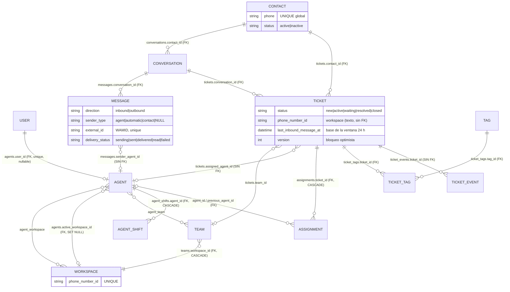

# 03 — Modelo de dominio

> Entidades, enums y relaciones tal como están en el código (`apps/api/src/Domain/`). Volver al [índice](README.md).
> Doctrine mapea **solo** `src/Domain` (`config/packages/doctrine.yaml:16-22`). La carpeta `src/Entity/` está vacía y no tiene significado.

## El modelo en 30 segundos

```text
Contacto (único por teléfono, global)
   └── Conversación  (una por contacto + número de WhatsApp; nunca se cierra)
          ├── Mensajes  (todos los mensajes, de todos los tickets)
          └── Tickets   (episodios de atención; a lo sumo uno no cerrado a la vez)
                 ├── Dueño: Agente (assigned_agent_id, sin FK)
                 ├── Equipo (team_id, opcional)
                 ├── Asignaciones (auditoría de cambios de dueño)
                 ├── Etiquetas
                 └── Eventos de ticket (auditoría: tags, cierres, reaperturas)

Usuario (login + roles) ──1:1 opcional── Agente ──N:M── Workspace (= un número de WhatsApp)
                                            ├──N:M── Equipo (pertenece a un workspace)
                                            └──1:N── Turnos
```

Tres ideas que explican casi todo lo demás:

1. **El mensaje pertenece a la conversación, no al ticket.** Por eso al abrir un ticket se ve también el historial de tickets anteriores del mismo contacto (`GetTicketMessagesQuery.php:22-52`). Los reportes de demora reconstruyen "qué mensajes son de qué ticket" por fechas (spec `response-delay-metrics`).
2. **El contacto es global; el workspace se infiere del ticket.** El vínculo ticket ↔ workspace es una coincidencia de texto (`tickets.phone_number_id` = `workspaces.phone_number_id`), sin FK. Un webhook de un número no registrado crea tickets igual.
3. **Usuario y Agente son cosas distintas.** El usuario inicia sesión; el agente atiende. Un admin puede no tener agente (y se le crea uno automáticamente al enviar un mensaje o cambiar de workspace).

## Diagrama entidad-relación



Tablas técnicas sin relaciones de negocio (no incluidas en el diagrama): `outbox_events`, `processed_events`, `rule_execution_logs`, `webhook_payloads`, `refresh_tokens`.

## Entidades

### Entidades de negocio

| Entidad (tabla) | Archivo | Qué representa en el negocio | Campos clave |
|---|---|---|---|
| `Contacto` (`contacts`) | `Contacto/Contacto.php` | La persona que escribe por WhatsApp. **Global**: compartido por todos los números. | `phone` (UNIQUE global), `name`, `status` (`active`/`inactive`; "borrar" = `inactive`), `channel` (`whatsapp`/`other`), `email`, `owner_id` (sin FK; **destino desconocido: Regla no confirmada**) |
| `Conversation` (`conversations`) | `Conversacion/Conversation.php` | Todo el historial de un contacto con un número. | `contact_id`, `status` (`open`/`closed`, pero `closed` **nunca se escribe**), `last_message_at`, `phone_number_id` |
| `Message` (`messages`) | `Conversacion/Message.php` | Un mensaje entrante o saliente. | `conversation_id`, `direction`, `external_id` (WAMID), `content`, `delivery_status` (default `sent`), `failed_reason`, `media` (JSON), `sender_agent_id` (sin FK), `sender_type` (desde 12/09/2026; filas anteriores en `NULL`, sin backfill a propósito) |
| `Ticket` (`tickets`) | `Ticket/Ticket.php` | Un caso de atención (episodio). | `contact_id`, `conversation_id`, `status`, `priority` (siempre `medium`, sin uso), `assigned_agent_id` (sin FK), `first_response_at`, `resolved_at`, `closed_at`, `version` (bloqueo optimista), `last_event_seq`, `phone_number_id`, `team_id`, `last_read_at`, `last_inbound_message_at` |
| `Asignacion` (`assignments`) | `Asignacion/Asignacion.php` | Auditoría de cada cambio de dueño. | `ticket_id`, `agent_id`, `previous_agent_id`, `type`, `assigned_at`, `assigned_by` (texto libre: `system`, `u:{id}` o lo que mande el cliente), `notes` |
| `Agente` (`agents`) | `Agente/Agente.php` | La persona que atiende. | `name`, `user_id`, `active`, `is_available` (**legacy, nunca se escribe**), `max_active_tickets` (default 10, mínimo 1), `timezone`, `is_available_override` + `override_until`, `signature`, `notification_sound`, `desktop_notifications`, `auto_reply_enabled`, `auto_reply_message`, `active_workspace_id` |
| `Turno` (`agent_shifts`) | `Disponibilidad/Turno.php` | Turno semanal recurrente en hora local del agente. | `day_of_week` (1-7), `start_time`, `end_time` (distintos; si fin < inicio, cruza medianoche); UNIQUE (agente, día, inicio, fin) |
| `User` (`user`) | `Administracion/User.php` | Credenciales y roles. | `email` (UNIQUE), `password_hash`, `roles` (JSON, sin validar en el backend), `is_active` |
| `Workspace` (`workspaces`) | `Administracion/Workspace.php` | Un número de WhatsApp Business. Ejemplo de negocio: un número para clientes y otro para contratistas (análisis de brecha, req. #0b). | `phone_number_id` (UNIQUE), `display_name`, `is_active`. **No guarda credenciales**: todos los números usan el mismo token de Meta. |
| `Equipo` (`teams`) | `Agente/Equipo.php` | Área dentro de un workspace (Sprint 18). | `workspace_id`, `name` (UNIQUE por workspace), `is_active` |
| `Etiqueta` (`tags`) | `Ticket/Etiqueta.php` | Etiqueta global (no por workspace). | `name` (minúsculas, normalizado, UNIQUE) |
| `EtiquetaDeTicket` (`ticket_tags`) | `Ticket/EtiquetaDeTicket.php` | Relación ticket ↔ etiqueta. | Relación unidireccional: ni `Ticket` ni `Etiqueta` tienen la colección inversa. |
| `EventoDeTicket` (`ticket_events`) | `Ticket/EventoDeTicket.php` | Historial de hechos de un ticket: tags, cierres manuales (`manual_{resolved,closed}_{owner,override,unowned}`), cierre por ventana (`window_expired_closed`), reaperturas (`window_reopened`, `auto_reopened`). | `ticket_id` (sin FK), `type` (texto), `source` (`system`, `manual`, `u:{id}`) |

### Entidades técnicas

| Entidad (tabla) | Archivo | Para qué existe |
|---|---|---|
| `OutboxEvent` (`outbox_events`) | `Compartido/Outbox/OutboxEvent.php` | Cola de eventos a publicar en Mercure (`pending` → `published` / `dead_letter`). `aggregate_id` mezcla IDs de ticket y de agente según `aggregate_type`. |
| `ProcessedEvent` (`processed_events`) | `Compartido/ProcessedEvent.php` | Idempotencia genérica (clave → resultado). Se usa para mensajes salientes y para el límite de auto-respuestas; no tiene que ver con tickets pese a su carpeta. |
| `RegistroDeRegla` (`rule_execution_logs`) | `Automatizacion/RegistroDeRegla.php` | Idempotencia y log de reglas automáticas. |
| `WebhookPayload` (`webhook_payloads`) | `Conversacion/WebhookPayload.php` | Copia cruda de cada POST de Meta, guardada antes de procesar. `processed` **nunca se pone en `true`**. Es lo único que queda si un mensaje se pierde. |
| `RefreshToken` (`refresh_tokens`) | `Autenticacion/RefreshToken.php` | Tokens de refresco de sesión (bundle Gesdinet). |

## Enums y valores fijos

| Enum | Archivo | Valores | Notas |
|---|---|---|---|
| `EstadoDeTicket` | `Ticket/EstadoDeTicket.php` | `new`, `active`, `waiting`, `resolved`, `closed` | `Ticket::setEstado()` acepta cualquier texto. Transiciones en [04 § F4](04-flujos.md#f4-transiciones-de-estado-del-ticket). |
| `ConversationStatus` | `Conversacion/ConversationStatus.php` | `open`, `closed` | `closed` nunca se usa. |
| `MessageDirection` | `Conversacion/MessageDirection.php` | `inbound`, `outbound` | Los casos de uso escriben el texto literal, no el enum. |
| `MessageSenderType` | `Conversacion/MessageSenderType.php` | `agent`, `automatic`, `contact` | Spec `message-attribution`. El frontend todavía no lo usa. |
| `TipoDeAsignacion` | `Asignacion/TipoDeAsignacion.php` | `AUTO_ASSIGN`, `MANUAL_ASSIGN`, `REASSIGN`, `UNASSIGN` | Solo `ResponsabilidadDeTicketService` crea filas de `Asignacion`. |
| Roles | strings en `User.roles` | `ROLE_ADMIN`, `ROLE_SUPERVISOR`, `ROLE_AGENT` | Jerarquía en `security.yaml` (el enum `Role`, sin uso, se borró en la fase 1). |
| `MediaKind` | `Conversacion/MediaKind.php` | `image`, `video`, `audio`, `document` | |
| `TipoDeEventoDeTicket` | `Ticket/TipoDeEventoDeTicket.php` | constantes de cierre/reapertura | `tag_added`, `tag_removed`, `auto_reopened`, `auto_closed` siguen como textos sueltos. |
| Estado de entrega (textos) | `Conversacion/UseCase/HandleStatusUpdateUseCase.php:29-44` | `sending` → `sent` → `delivered` → `read`; `failed` | Solo avanza; `read` y `failed` son finales. |

## Relaciones: cardinalidad y claves foráneas

| Relación | Cardinalidad | ¿FK real? | Observación |
|---|---|---|---|
| User ↔ Agente | 1 : 0..1 | Sí (`agents.user_id`, unique, `ON DELETE SET NULL`) | Vínculo opcional. |
| Agente ↔ Workspace | N : M (`agent_workspace`) | Sí | Determina qué workspaces puede elegir un agente. |
| Agente → Workspace activo | N : 0..1 | Sí (`SET NULL`) | Preferencia del selector. |
| Equipo → Workspace | N : 1 | Sí (`CASCADE`) | |
| Agente ↔ Equipo | N : M (`agent_team`) | Sí | Solo agentes del mismo workspace (`Equipo::addAgente()`). |
| Agente → Turno | 1 : N | Sí (`CASCADE`) | |
| Contacto → Conversation | 1 : N (una por número) | Sí | |
| Conversation → Message | 1 : N | Sí | |
| Contacto / Conversation → Ticket | 1 : N | Sí | A lo sumo un ticket no cerrado por contacto y número (regla en código, no en BD). |
| Ticket → Equipo | N : 0..1 | `Ticket::$team` (`ManyToOne`, FK `ON DELETE SET NULL`). | — |
| Ticket → Agente (dueño) | N : 0..1 | **No** | Motivo de no tener FK: **Regla no confirmada**. Desactivar un agente no le quita sus tickets. |
| Message → Agente (autor) | N : 0..1 | **No** (por spec `message-attribution`, copiando la decisión anterior) | |
| Ticket → Asignacion | 1 : N | Sí (`CASCADE`) | |
| Ticket ↔ Tag | N : M (`ticket_tags`) | Sí | |
| Ticket → EventoDeTicket | 1 : N | **No** | |
| Ticket / Conversation → Workspace | N : 1 | **No** (coincidencia de `phone_number_id`) | |
| Contact → "owner" | ? | **No** | `contacts.owner_id` solo se usa como filtro en `ListContactosQuery.php:54`. A qué apunta: **Regla no confirmada.** |
