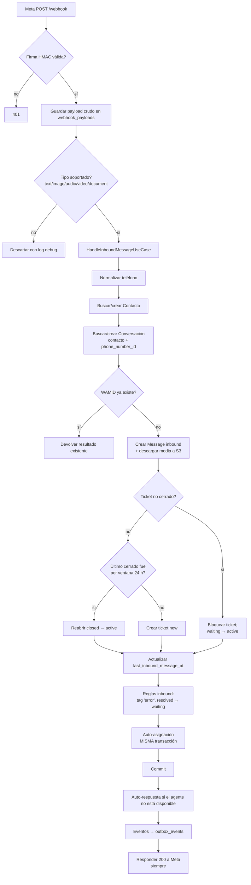
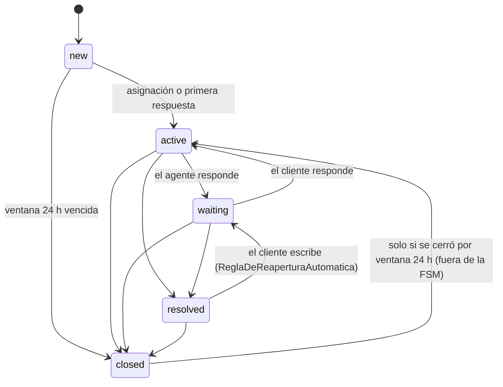

# 04 — Flujos de punta a punta

> Cómo fluye cada operación real, paso a paso, con los archivos involucrados. Volver al [índice](README.md).
> Rutas del backend relativas a `apps/api/src/`; del frontend, a `apps/web/src/app/`. Los IDs de reglas (R-T1, R-A6…) remiten a [05-reglas-de-negocio.md](05-reglas-de-negocio.md).

## Índice de flujos

| # | Flujo | Disparador |
|---|---|---|
| [F1](#f1-mensaje-entrante-de-whatsapp) | Mensaje entrante de WhatsApp | Meta → `POST /webhook` |
| [F2](#f2-respuesta-del-agente) | Respuesta del agente (texto o adjunto) | Composer → `POST /api/provider/send` |
| [F3](#f3-envío-de-plantilla) | Envío de plantilla | Solo API → `POST /api/provider/template/send` |
| [F4](#f4-transiciones-de-estado-del-ticket) | Transiciones de estado (resolver, cerrar) | Botón "Resolver" / API |
| [F5](#f5-asignación-manual) | Asignación manual | Desplegable de la bandeja |
| [F6](#f6-asignación-automática) | Asignación automática | Cada mensaje entrante / API |
| [F7](#f7-disponibilidad-override-y-turnos) | Disponibilidad, override y turnos | `/settings` / API |
| [F8](#f8-ventana-de-24-h-cierre-automático-y-reapertura) | Ventana de 24 h: cierre y reapertura | Proceso `window-closer` / mensaje entrante |
| [F9](#f9-reglas-automáticas-y-auto-respuesta) | Reglas automáticas y auto-respuesta | Mensaje entrante |
| [F10](#f10-etiquetas) | Etiquetas | Regla automática |
| [F11](#f11-contactos-e-importación-csv) | Contactos e importación CSV | Pantalla Contactos |
| [F12](#f12-equipos) | Equipos | Admin → Equipos / filtro bandeja |
| [F13](#f13-eventos-de-dominio-outbox-y-tiempo-real) | Eventos, outbox y tiempo real | Casos de uso → Mercure → navegador |
| [F14](#f14-estado-de-entrega-de-mensajes) | Estado de entrega | Meta → `POST /webhook` (`statuses`) |
| [F15](#f15-reportes-y-exportación) | Reportes y exportación | Pantalla Informes |
| [F16](#f16-inicio-de-sesión-y-workspace-activo) | Inicio de sesión y workspace activo | Login / selector |
| [F17](#f17-bandeja-listar-abrir-y-marcar-como-leído) | Bandeja: listar, abrir, marcar leído | Pantalla Chats |
| [F18](#f18-administración-de-usuarios-agentes-y-workspaces) | Administración | Pantallas `/admin/*` |

---

## F1. Mensaje entrante de WhatsApp

**Entrada:** `POST /webhook` → `Conversacion/Controller/WebhookController::handle` (`#[Route]` del método). Público, autenticado por firma HMAC.

| # | Paso | Dónde | Regla |
|---|---|---|---|
| 1 | GET: verificación de suscripción (`hub.verify_token`). | `WebhookController.php:56-80` | |
| 2 | POST: valida `X-Hub-Signature-256` (HMAC-SHA256 con `META_APP_SECRET`). Inválida → 401. JSON inválido → 400. | `:98-119`, `:150-164` | R-M8 |
| 3 | Guarda el payload crudo en `webhook_payloads` (si falla, se loguea y sigue). | `:121-130`; `Conversacion/UseCase/RecordWebhookPayloadUseCase.php` | |
| 4 | Por cada `entry[].changes[].value` de WhatsApp: toma `metadata.phone_number_id` y el nombre de perfil. Descarta tipos no soportados. | `Conversacion/UseCase/ProcessWebhookPayloadUseCase.php:38-118` | R-M1 |
| 5 | Llama `HandleInboundMessageUseCase::processInboundMessage()`. Cualquier excepción se loguea **y se traga**. | `ProcessWebhookPayloadUseCase.php:119-143`; los estados no tienen catch propio (`:147-151`) | |
| 6 | Normaliza el teléfono (solo dígitos, mínimo 10, antepone `+`). | `Conversacion/UseCase/HandleInboundMessageUseCase.php:69-75` | R-C2 |
| 7 | Busca o crea el contacto (no mira si está `inactive`). | `:212-228` | R-C3 |
| 8 | Busca la conversación `open` del contacto para ese número; si no hay, la crea. | `:230-244` | |
| 9 | Si el WAMID ya existe, termina (idempotencia ante reintentos de Meta). | `:178-187`, `:246-253` | R-M2 |
| 10 | Crea el `Message` (`inbound`, `sender_type=contact`); si hay media, la descarga de Meta y la sube a S3 (errores tragados). | `:256-321` | R-M4 |
| 11 | Busca un ticket no cerrado del contacto en ese número. Si no hay, intenta reabrir uno cerrado por ventana; si no, crea uno `new`/`medium`. | `:330-372`; `Ticket/Repository/TicketRepository.php:42-61, 105-132` | R-T1, R-T16 |
| 12 | Si el ticket existía: bloqueo pesimista; `waiting → active`. | `:374-388`, `:394-408` | R-T7 |
| 13 | Actualiza `last_message_at`, `updated_at` y **`last_inbound_message_at`** (único escritor). | `:410-423` | R-W3 |
| 14 | Recolecta `TicketCreatedEvent` / `MessageCreatedEvent`. | `:429-455` | |
| 15 | Ejecuta reglas `inbound` (`ReglaDeEtiquetadoPorPalabraClave`, `ReglaDeReaperturaAutomatica`). | `:461-465` | R-R1, R-T8 |
| 16 | Despacha `TicketRequiereAsignacionAutomaticaEvent` → listener → `AsignarTicketAutomaticamenteUseCase::executeInTransaction()` **dentro de la misma transacción**. | `:466-468`; `Asignacion/EventListener/AsignacionAutomaticaSolicitadaListener.php:17-20` | ver F6 |
| 17 | Commit. Después: `RespuestaAutomaticaService::enviarSiCorresponde()` y escritura de eventos en el outbox. | `:83-99`, `:107-156` | ver F9, F13 |

- **Entidades:** Contacto, Conversation, Message, Ticket, EventoDeTicket, Etiqueta/EtiquetaDeTicket, Asignacion, Agente, OutboxEvent, WebhookPayload, ProcessedEvent, RegistroDeRegla.
- **Persistencia:** `webhook_payloads`, `contacts`, `conversations`, `messages`, `tickets`, `ticket_events`, `tags`/`ticket_tags`, `rule_execution_logs`, `assignments`, `processed_events`, `outbox_events`.
- **Efectos laterales:** descarga de media de Meta; posible auto-respuesta por Graph API; eventos en tiempo real.
- **Resultado:** el mensaje queda en la conversación; el ticket queda `new` (sin dueño), `active` (con dueño auto-asignado) o `waiting` (si estaba resuelto).
- **Riesgos:** si la auto-asignación falla se revierte todo y el mensaje se pierde ([R9](00-estado-y-pendientes.md#r9-la-auto-asignación-puede-hacer-perder-mensajes-entrantes)); si hubiera dos tickets no cerrados, `getOneOrNullResult()` lanza excepción y el mensaje se pierde.
- **Otra entrada:** `POST /debug/inbound/{ticketId}` (admin, solo entorno `dev`/`test`) llama al mismo caso de uso **sin `phone_number_id`**: el ticket resultante no aparece en la bandeja de un usuario con workspace activo.

**Si falla, revisar:**
1. Logs de PHP (`docker logs inbiox_php`) y la tabla `webhook_payloads` (¿llegó el POST?).
2. `Conversacion/Controller/WebhookController.php` (firma, JSON) y `Conversacion/UseCase/ProcessWebhookPayloadUseCase.php` (tipo de mensaje, excepciones tragadas en `:136-142`).
3. `Conversacion/UseCase/HandleInboundMessageUseCase.php`.
4. `Asignacion/UseCase/AsignarTicketAutomaticamenteUseCase.php` (una excepción aquí revierte el mensaje).
5. `Ticket/Repository/TicketRepository.php:42-61` (búsqueda del ticket no cerrado).
6. `Conversacion/MediaDownloadService.php` (si falta el adjunto).

---

## F2. Respuesta del agente

**Entrada:** Composer → `MessageSenderService.send()` → `SendMessageUseCase` → `WhatsAppCloudProvider.sendMessage()` → `POST /api/provider/send` → `Conversacion/Controller/ProviderProxyController::send` → `Conversacion/UseCase/SendOutboundMessageUseCase.php`, `ROLE_AGENT`.

| # | Paso | Dónde | Regla |
|---|---|---|---|
| 1 | (Frontend) Si la ventana de 24 h venció según el reloj del navegador, el composer se reemplaza por un aviso. | `features/inbox/components/composer/composer.component.ts:70-76` | R-W1 (copia) |
| 2 | (Frontend) Adjuntos: valida tipo/tamaño, sube con `POST /api/provider/media/upload`, luego envía con `mediaId`. | `features/inbox/services/message-sender.service.ts:131-134, 226-252` | |
| 3 | Valida `ticketId` y `content`. Resuelve el agente del usuario; **si no tiene, lo crea** (nombre = email). | `ProviderProxyController.php:46-66`; `Agente/UseCase/EnsureAgentForUserUseCase.php` | R-A12 |
| 4 | `senderIsPrivileged = isGranted('ROLE_SUPERVISOR')`. | `:76` | |
| 5 | Idempotencia: clave `outbound:{ticketId}:md5(texto o media)`; si ya existe, devuelve `duplicate_skipped` sin persistir. | `Conversacion/UseCase/HandleOutboundMessageUseCase.php:83-102` | R-M3 |
| 6 | Hasta 3 intentos ante bloqueo optimista; transacción con `SELECT … FOR UPDATE`. | `:106-188` | |
| 7 | **Guard de ticket resuelto/cerrado:** si el remitente no es supervisor/admin ni el dueño → 409 `TICKET_NOT_OWNED`. | `:197-204`; `Ticket/TicketResponsabilidadGuard.php:35-46` | R-A7 |
| 8 | **Guard de ventana de 24 h:** vencida o sin mensaje del cliente → 422 `CONVERSATION_WINDOW_EXPIRED`, sin persistir nada. | `:210-212`; `Conversacion/ConversationWindowPolicy.php:30-56` | R-W1 |
| 9 | **Auto-claim:** si el ticket no está resuelto/cerrado y el remitente no es el dueño → `AUTO_ASSIGN` (sin dueño) o `REASSIGN` (otro dueño). No mira disponibilidad ni capacidad. | `:222-254` | R-A6 |
| 10 | Crea el `Message` (`outbound`, `sender_type=agent`, `sender_agent_id`). | `:257-269` | R-M4 |
| 11 | Estado: `new → active`, `active → waiting`; registra `first_response_at`. Como el paso 9 ya pasó `new → active`, el primer mensaje deja el ticket en `waiting`. | `:272-305` | R-T5, R-T6 |
| 12 | Guarda `ProcessedEvent`, recolecta `MessageCreatedEvent`, commit, escribe outbox (omite `InboxUpdatedEvent`, agrega `assignee_id`). | `:308-426` | |
| 13 | **Recién ahora** llama a Graph API (`sendMessage` o `sendMediaMessage`) con el `phone_number_id` del ticket. Si falla → error al usuario, **pero el mensaje ya quedó guardado como `sent`** y el ticket ya cambió. | `SendOutboundMessageUseCase.php:77-97`; errores → JSON en `ProviderProxyController.php:72-123` | R-M6 |
| 14 | Guarda el WAMID en `messages.external_id` (para correlacionar estados de entrega). | `:174-184` | |
| 15 | (Frontend) Confirma el mensaje optimista; si falla, `retryWithBackoff` **reintenta el POST 2 veces**. | `message-sender.service.ts:41-45, 71-74` | |

- **Entidades:** Ticket, Message, Asignacion, Agente, ProcessedEvent, OutboxEvent.
- **Resultado:** mensaje en WhatsApp y en la conversación; el remitente pasa a ser dueño (salvo resuelto/cerrado).
- **Confirmado por lectura (no reproducido en ejecución):** ante un duplicado (paso 5) el caso de uso devuelve `status = duplicate_skipped` y `message_id = null`, pero `SendOutboundMessageUseCase` **no revisa ese resultado** (`:69-91`) y llama a Graph igual: el texto repetido se envía a WhatsApp sin quedar guardado. Combinado con el reintento automático del frontend (paso 15), un error de red puede hacer que el cliente reciba **el mismo mensaje hasta 3 veces**, mientras la base muestra uno solo. La idempotencia protege la base, no al cliente. Ver [R10](00-estado-y-pendientes.md#r10-mensaje-marcado-enviado-que-no-se-envió).

**Si falla, revisar:**
1. Respuesta HTTP: 422 = ventana de 24 h; 409 `TICKET_NOT_OWNED` = guard de resuelto ([R6](00-estado-y-pendientes.md#r6-resolver-quita-el-dueño-contradicción-autoinfligida)); 422/429/502 desde `mapGraphErrorCode` = error de Meta.
2. `Conversacion/UseCase/SendOutboundMessageUseCase.php::execute`, y `Conversacion/Controller/ProviderProxyController.php::send` y `::mapGraphErrorCode` (`:301-323`).
3. `Conversacion/UseCase/HandleOutboundMessageUseCase.php`.
4. `Conversacion/ConversationWindowPolicy.php`, `Ticket/TicketResponsabilidadGuard.php`.
5. `Compartido/Graph/GraphClient.php` (incluye el workaround `normalizePhone()` para un número de prueba).
6. Frontend: `message-sender.service.ts`, `core/providers/whatsapp-cloud.provider.ts` (rutas relativas `/api/provider/*`).

---

## F3. Envío de plantilla

**Entrada:** `POST /api/provider/template/send` → `ProviderProxyController::sendTemplate` (`:159-225`) → `Conversacion/UseCase/SendTemplateUseCase.php`, `ROLE_AGENT`. **No hay UI** (`WhatsAppCloudProvider.sendTemplate()` no se llama).

1. Valida `ticketId`, `templateName`, `language`, `parameters` (array).
2. Carga ticket → contacto → teléfono (`Ticket::telefonoDestinatario()`, compartido con `send`).
3. `GraphClient::sendTemplate(...)` con el `phone_number_id` del ticket.
4. Si Meta devuelve WAMID, resuelve el agente (lo crea si el usuario no tiene; solo en este caso) y persiste un `Message` outbound con contenido `"Template: {nombre} (params)"`, `sender_type=agent`. Devuelve `messageId` = WAMID (no el id de base, a diferencia de `send`).

**Lo que este flujo no hace** (a diferencia de F2): no valida la ventana de 24 h (**correcto y deliberado**, R-W6); no aplica guard de dueño, auto-claim, cambio de estado, `first_response_at`, idempotencia ni eventos de tiempo real. Si esas omisiones son intencionales: **Regla no confirmada**. Para la métrica de demora, la plantilla cuenta como respuesta humana.

**Si falla, revisar:** `ProviderProxyController::sendTemplate` → `SendTemplateUseCase` → `GraphClient::sendTemplate` → configuración de la plantilla en Meta.

---

## F4. Transiciones de estado del ticket

**Máquina de estados** (`Ticket/MaquinaDeEstadosDeTicket.php:34-54`):

`closed` es terminal para la FSM. La reapertura por ventana usa SQL directo a propósito (design D1).

**Entradas:**

| Endpoint | Controlador | Quién puede |
|---|---|---|
| `POST /api/tickets/{id}/resolve` (botón "RESOLVER" de la conversación) | `FlujoDeTicketController::resolver` (`:88`) | Dueño, supervisor, admin (voter `CLOSE`) |
| `POST /api/tickets/{id}/close` (sin UI) | `::close` (`:116`) | Igual, pero solo acepta tickets `resolved`, que ya no tienen dueño → en la práctica **solo supervisor/admin** |
| `POST /api/tickets/{id}/transition` `{status, set_first_response, set_resolved}` (sin UI) | `::transition` (`:39-85`) | Voter `CLOSE` solo si el destino es `resolved`/`closed`; **cualquier otra transición, cualquier agente** (R-T14) |

| # | Paso (resolver) | Dónde | Regla |
|---|---|---|---|
| 1 | Voter `CLOSE`: supervisor/admin siempre; agente solo si es el dueño. | `Ticket/Security/TicketVoter.php:76-121`; `FlujoDeTicketController.php:136-155` | R-T13 |
| 2 | `CambiarEstadoDeTicketUseCase::resolver()` → `execute()`: valida FSM, setea `resolved_at` y `first_response_at`. | `Ticket/UseCase/CambiarEstadoDeTicketUseCase.php:72-139, 263-266` | R-T3, R-T12 |
| 3 | **Si hay dueño: `UNASSIGN`** → `ResponsabilidadDeTicketService` pone `assigned_agent_id = null` y crea fila `Asignacion`. | `:37-61` (llamado en `:99`, `:172`, `:289`); `Asignacion/ResponsabilidadDeTicketService.php:65` | R-T9 |
| 4 | El controlador clasifica el cierre (`owner`/`override`/`unowned`) y guarda un `EventoDeTicket` con `source = u:{userId}`. Si falla, solo se loguea. | `Ticket/ClasificadorDeAuditoriaDeCierre.php:25-38`; `Ticket/UseCase/RegistrarAuditoriaDeCierreUseCase.php` | R-T15 |
| 5 | **No se escribe nada en el outbox**: los demás navegadores no se enteran hasta recargar. | — | P-5 |

**Quién más cambia `tickets.status`** (fuera de este flujo): `ResponsabilidadDeTicketService` (`new → active` al asignar), `HandleInboundMessageUseCase` (`waiting → active`), `HandleOutboundMessageUseCase` (`new → active`, `active → waiting`), `ReglaDeReaperturaAutomatica` (`resolved → waiting`), `cerrarPorVentanaVencida` y `reabrirPorMensajeEntrante` (F8), `DebugController::status` (dev).

**Si falla, revisar:**
1. 403 → voter: `TicketVoter.php` (¿el usuario tiene agente vinculado? ¿es el dueño?).
2. 409 / error de transición → `MaquinaDeEstadosDeTicket.php`.
3. `CambiarEstadoDeTicketUseCase.php`.
4. Frontend: `features/inbox/containers/conversation/conversation.component.ts:295-322`, `core/api/workflow-api.service.ts:32-37`.

---

## F5. Asignación manual

**Entrada:** desplegable de la tarjeta del ticket → `TicketListComponent.onAssign()` → `POST /api/tickets/{id}/assign` `{agentId, assignedBy, notes}` → `Asignacion/Controller/AsignacionDeTicketController::assign` (`:35-75`).

| # | Paso | Dónde | Regla |
|---|---|---|---|
| 1 | (Frontend) El desplegable se muestra si el usuario es supervisor/admin, o si es agente y dueño; solo en `new`/`active`/`waiting`. Excluye al propio usuario. Los agentes "Inactivo" no se pueden elegir. | `features/inbox/containers/ticket-list/ticket-list.component.ts:121-149, 219-236`; `features/inbox/components/ticket-card/ticket-card.component.ts:51-59, 138-150` | |
| 2 | (Frontend) Roster: `GET /api/workspaces/{wsId}/available-agents` → agentes activos del workspace con `is_active_now`, "Activo" primero. | `Disponibilidad/Controller/AgentesDisponiblesController.php:29-47`; `DisponibilidadDeAgenteService::listarAgentesDelEspacioDeTrabajo()` (`:181-224`) | |
| 3 | Voter `ASSIGN`: ticket `resolved`/`closed` → 409 para todos; supervisor/admin pasan; agente solo si ya es el dueño. | `TicketVoter.php:88-118` | R-A9, R-A10 |
| 4 | Valida `agentId > 0` y `assignedBy` (texto **enviado por el cliente**). | `Asignacion/UseCase/AsignarTicketUseCase.php:57-66` | R-A11 |
| 5 | Transacción; carga ticket y luego `lock()` (patrón con riesgo TOCTOU, [R16](00-estado-y-pendientes.md#r16-concurrencia-en-asignación-manual-toctou)). | `:70-84` | |
| 6 | **Guard "Activo":** `isActivoAhora()` (cuenta activa → override → turno; **sin capacidad**). Si no → 409 `AGENT_NOT_ACTIVE`. Sin excepción para ningún rol. | `:86-95`; `DisponibilidadDeAgenteService.php:83-101` | R-A8 |
| 7 | `REASSIGN` si ya tenía dueño, si no `MANUAL_ASSIGN` → `ResponsabilidadDeTicketService::registrarCambioDeResponsable()` (fila `Asignacion`, `new → active`, eventos). | `:97-117`; `ResponsabilidadDeTicketService.php:45-111` | R-A1, R-T4 |
| 8 | Post-commit: eventos al outbox (los `InboxUpdatedEvent` terminan en dead letter). | `:135, 143-180` | P-1 |
| 9 | (Frontend) Actualización optimista; si falla, rollback y mensaje 5 s; si 409 `AGENT_NOT_ACTIVE`, recarga el roster. | `ticket-list.component.ts:242-277` | |

- **No verifica workspace** del agente destino. **No existe endpoint para desasignar**: `UNASSIGN` solo ocurre al resolver/cerrar.
- **Historial:** `GET /api/tickets/{id}/assignment` (`Asignacion/Controller/AsignacionDeTicketController.php:99-135`) — sin UI.

**Si falla, revisar:** 409 `AGENT_NOT_ACTIVE` → turnos/override del agente (F7); 409 sin tipo → ticket resuelto/cerrado; 403 → voter `TicketVoter.php`; luego `AsignarTicketUseCase.php`, `ResponsabilidadDeTicketService.php`, y en el frontend `ticket-list.component.ts` y `ticket-card.component.ts`.

---

## F6. Asignación automática

**Entradas:** cada mensaje entrante (F1, paso 16) y `POST /api/tickets/{id}/auto-assign` (`Asignacion/Controller/AsignacionAutomaticaController.php`, cualquier agente, sin UI).

| # | Paso | Dónde | Regla |
|---|---|---|---|
| 1 | `SELECT … FOR UPDATE` del ticket. | `Asignacion/UseCase/AsignarTicketAutomaticamenteUseCase.php:85-88` | |
| 2 | Si ya tiene dueño → `already_assigned`. **No mira el estado**: un ticket resuelto sin dueño es candidato. | `:100-107` | R-A5 |
| 3 | `listarAgentesDisponibles()`: **todos** los agentes activos del sistema (sin filtro de workspace ni equipo), con cascada override → turno → capacidad. | `:112`; `DisponibilidadDeAgenteService.php:111-166` | R-A4, R-D1 |
| 4 | Bloquea las filas de esos agentes y recalcula la carga (`new`/`active`/`waiting`) dentro del lock; descarta los que están al tope (incluso con override). | `:126-151` | R-A3 |
| 5 | Desempate: menor carga → menos `AUTO_ASSIGN` hoy (UTC) → menor `agent.id`. | `:163-174` | R-A2 |
| 6 | `registrarCambioDeResponsable(..., AUTO_ASSIGN, 'system')`. | `:194-200` | |
| 7 | Vía endpoint escribe eventos; vía mensaje entrante los deja en el colector (se publican sin `assignee_id`, P-4). | `:216-252` | |

- **Razones de no asignación:** `ticket_not_found`, `already_assigned`, `no_agents_available`, `all_agents_at_capacity`.
- **No hay rebalanceo**: si nadie estaba disponible, el ticket queda sin dueño hasta que el cliente vuelva a escribir o alguien lo asigne. Existía `RebalanceUnassignedTicketsUseCase`, sin llamadores; se borró en la fase 1. Regla no confirmada.

**Si falla, revisar:** `AsignarTicketAutomaticamenteUseCase.php` → `DisponibilidadDeAgenteService::listarAgentesDisponibles()` → turnos y zona horaria de los agentes (`agent_shifts`, `agents.timezone`) → `max_active_tickets`.

---

## F7. Disponibilidad, override y turnos

**Cuatro criterios distintos de "disponible"** conviven (más una copia duplicada). Verificado en `Disponibilidad/DisponibilidadDeAgenteService.php`:

| Criterio | Qué mira | Dónde | Lo usa |
|---|---|---|---|
| Columna `agents.is_available` | Nada (nadie la escribe; siempre `true`) | `Agente/Agente.php:36-37` | Solo se muestra en la API admin (`Administracion/Controller/AgentController.php:136`). **Legacy.** |
| `isDisponible()` / `listarAgentesDisponibles()` | activo → override → turno → **capacidad** | `:40-68`, `:112-167` | Auto-asignación, auto-respuesta, `GET /api/agents/{id}/availability`, reporte de disponibles |
| `isActivoAhora()` ("Activo/Inactivo") | activo → override → turno (**sin capacidad**) | `:84-102` | Guard de asignación manual y roster del desplegable |
| `isEnTurno()` | activo → turno (sin override ni capacidad) | `:233-242` | Listado de tickets y reporte de rendimiento |
| *(copia)* `DisponibilidadDeAgenteController::isAgenteEnTurno()` | turno (no mira `active`) | `Disponibilidad/Controller/DisponibilidadDeAgenteController.php:338-367` | Campo `is_in_shift` de `GET /api/agents/{id}/availability` |

> Corrección: un informe previo hablaba de "cinco definiciones". Son **cuatro criterios** (contando la columna legacy, que en realidad no evalúa nada) más **una copia** del criterio de turno en un controlador.

**Entradas:**

| Operación | Endpoint | Caso de uso | Desde la UI |
|---|---|---|---|
| Reemplazar mis turnos | `PUT /api/me/shifts` | `ReemplazarTurnosUseCase` (`:56-90`) | Sí, `/settings` → Horario laboral |
| Crear/borrar turno de un agente | `POST /api/agents/{id}/shifts`, `DELETE …/shifts/{shiftId}` | `CreateTurnoUseCase` (`:105-137`), `DeleteTurnoUseCase` | **No** (página rota) |
| Override | `POST/DELETE /api/agents/{id}/availability` | `SetDisponibilidadManualUseCase` (`:42-91`), `QuitarDisponibilidadManualUseCase` | **No** |
| Zona horaria | `PUT /api/admin/agents/{id}` | `Administracion/Controller/AgentController::update` | Sí, Admin → Agentes |

- Los turnos se interpretan en la zona horaria del agente, intervalo `[inicio, fin)`, con cruce de medianoche (`DisponibilidadDeAgenteService.php:261-289`). No se validan turnos superpuestos. Las validaciones están duplicadas en dos casos de uso con nombres de campo distintos (`day_of_week` vs `dayOfWeek`).
- Override y turnos escriben eventos `agent.*` en el outbox que el frontend no escucha.
- **Seguridad:** cualquier agente puede llamar estos endpoints sobre cualquier otro ([R3](00-estado-y-pendientes.md#r3-cualquier-agente-modifica-disponibilidad-y-turnos-de-cualquier-agente)).

**Si falla, revisar:** `DisponibilidadDeAgenteService.php` (qué criterio usa el caso concreto) → `agent_shifts` + `agents.timezone` + `agents.is_available_override/override_until` → `Disponibilidad/Controller/DisponibilidadDeAgenteController.php` / `Disponibilidad/Controller/MisTurnosController.php::reemplazarTurnos`.

---

## F8. Ventana de 24 h: cierre automático y reapertura

**Política** (`Conversacion/ConversationWindowPolicy.php`): límite = `last_inbound_message_at + 24 h − margen` (5 min, `CONVERSATION_WINDOW_SAFETY_MARGIN_MINUTES`). Para **enviar**, sin mensaje del cliente = ventana cerrada. Para **cerrar**, sin mensaje del cliente = no se cierra (evita cerrar en masa tickets viejos).

**Cierre automático:**

| # | Paso | Dónde |
|---|---|---|
| 1 | El servicio docker `window-closer` (profile opcional) corre `app:conversation-window:close-expired` cada 900 s. | `docker-compose.yml`; `Conversacion/Command/CloseExpiredConversationWindowsCommand.php` |
| 2 | Selecciona hasta 200 tickets `new`/`active`/`waiting`/`resolved` con ventana vencida. | `Conversacion/UseCase/ConversationWindowExpiryService.php:55-93` |
| 3 | Por cada uno: `cerrarPorVentanaVencida()` → FSM a `closed`, `UNASSIGN` si hay dueño, `closed_at`, `EventoDeTicket(window_expired_closed, system)`. Un error en un ticket no corta el lote. | `CambiarEstadoDeTicketUseCase.php:152-192` |

**Reapertura:** cuando llega un mensaje y no hay ticket no cerrado (F1 paso 11), si el **último** `ticket_event` del ticket cerrado es `window_expired_closed`, se reabre `closed → active` por SQL, `closed_at = NULL`, `EventoDeTicket(window_reopened)`; queda sin dueño y la auto-asignación del mismo mensaje lo reasigna (`CambiarEstadoDeTicketUseCase.php:210-258`). Un cierre manual nunca se reabre: el siguiente mensaje crea un ticket nuevo. Si después del cierre por ventana se agregó otro evento (p. ej. un tag), ya no es reabrible.

**Si falla, revisar:** ¿está corriendo `inbiox_window_closer` (`docker ps`)? → ejecutar el comando con `--dry-run` → `ConversationWindowExpiryService.php` → `ConversationWindowPolicy.php` → `tickets.last_inbound_message_at` del ticket → `TicketRepository.php:105-132` (reapertura).

---

## F9. Reglas automáticas y auto-respuesta

**Motor:** `Automatizacion/EjecutorDeReglas.php:36-74`. Para cada regla que soporta el disparador: arma una clave, si ya existe en `rule_execution_logs` la salta, ejecuta y registra éxito o fallo. **Una regla que falló nunca se reintenta** (la misma clave ya existe). Las reglas se registran a mano en `Automatizacion/DependencyInjection/ReglaPass.php:29-33`.

| Regla | Disparador | Qué hace | ¿Corre? |
|---|---|---|---|
| `Automatizacion/ReglaDeEtiquetadoPorPalabraClave.php` | `inbound` | Si el texto contiene "error" (subcadena) → tag `error`. | **Sí** (demo hardcodeada). |
| `Automatizacion/ReglaDeReaperturaAutomatica.php` | `inbound` | `resolved → waiting` + `EventoDeTicket(auto_reopened)`. | **Sí.** |
| ~~`Domain/Rule/AutoCloseRule.php`~~ | `manual` | `resolved → closed` si `updated_at` ≥ 24 h. | **Borrado en la fase 1 de la limpieza.** Nunca se disparaba. |

**Auto-respuesta** (`Automatizacion/RespuestaAutomaticaService.php`, post-commit del mensaje entrante):

1. Agente objetivo: el dueño si está activo; si no, el **primer** agente activo con auto-respuesta habilitada del workspace del ticket (`:207-238`).
2. Requiere `auto_reply_enabled` y mensaje no vacío (`:79-86`).
3. Solo responde si ese agente **no** está disponible según `isDisponible()` (incluye capacidad): un agente en turno pero lleno dispara el aviso de ausencia (`:88-92`).
4. Máximo una por contacto cada **2 h** (`HORAS_DE_VENTANA_DE_RESPUESTA_AUTOMATICA = 2`, `:38`; el docblock `:31` y el análisis de brecha dicen 4 h). Guardado en `processed_events`.
5. Respeta la ventana de 24 h; envía por Graph; persiste el mensaje con `sender_type=automatic`.

**Si falla, revisar:** `RespuestaAutomaticaService.php` (errores tragados en `:60-66`) → configuración del agente en `/settings` → `processed_events` (clave `auto-reply:{contactId}`) → `rule_execution_logs` para las reglas.

---

## F10. Etiquetas

- **Productor único hoy:** `ReglaDeEtiquetadoPorPalabraClave` (tag `error`).
- `AgregarEtiquetaATicketUseCase` existe (normaliza a minúsculas, es idempotente, audita en `ticket_events`) y solo lo usa `ReglaDeEtiquetadoPorPalabraClave`. **No hay forma HTTP de etiquetar a mano**: `TagController` (sin ruta) y `RemoveTagFromTicketUseCase` se borraron en la fase 1.
- **Filtro:** `GET /api/tickets?tag=a,b` (AND, máximo 5) en `Ticket/Query/FiltrosDeTicketBuilder.php:79-87`, y columna `tags` del export CSV. **Sin UI.**

**Si falla, revisar:** `debug:router` (no hay ruta) → `FiltrosDeTicketBuilder.php` → `ticket_tags`.

---

## F11. Contactos e importación CSV

| Operación | Endpoint | Caso de uso / clase | Notas |
|---|---|---|---|
| Listar | `GET /api/contacts?page&limit` | `ListContactosQuery` (con `WorkspaceScope`) | Frontend: 20 por página, búsqueda y filtros **en el navegador**. |
| Detalle | `GET /api/contacts/{id}` | `GetDetalleDeContactoQuery` | Sin filtro de workspace. |
| Crear | `POST /api/contacts` | `CreateContactoUseCase.php:19-81` | Teléfono obligatorio, normalizado con `NormalizadorDeTelefono`, único global; valores inválidos de `status`/`channel` se ignoran. |
| Editar | `PUT /api/contacts/{id}` | `UpdateContactoUseCase.php:17-85` | Normaliza el teléfono con **código propio**; valores inválidos lanzan error (inconsistente con crear). |
| Borrar | `DELETE /api/contacts/{id}` | `DeleteContactoUseCase.php:16-29` | Borrado lógico (`inactive`). Sin UI. El contacto sigue generando tickets. |
| Importar | `POST /api/contacts/import` (supervisor+) | `ImportarContactosDesdeCsvUseCase.php` | Máx. 2 MB y 1000 filas (rechazo total antes de escribir); delimitador `,` o `;`; columna `phone` obligatoria; duplicados se saltean (nunca actualiza); errores truncados a 100; cada fila pasa por `CreateContactoUseCase`. Spec `contact-import`. |
| Línea de tiempo | `GET /api/contacts/{id}/timeline?before&limit` | `GetLineaDeTiempoDeContactoQuery` | Tickets, mensajes y `ticket_events`. |

Frontend: `features/contacts/` (pages, componentes de diálogo, `stores/contacts.store.ts`, `stores/contact-timeline.store.ts`).

**Si falla, revisar:** el caso de uso de la tabla → `NormalizadorDeTelefono` (umbral de dígitos) → `features/contacts/components/contact-import-dialog/` (el import llama a la API directo).

---

## F12. Equipos

| Operación | Endpoint | Dónde | Notas |
|---|---|---|---|
| CRUD | `/api/admin/teams[/{id}]` (supervisor+) | `Administracion/Controller/TeamController.php` | Nombre único por workspace; borrar = desactivar (no toca `tickets.team_id`). |
| Membresía | `PUT /api/admin/teams/{id}/agents` | `:247-287` | Reemplaza la lista completa; `Equipo::addAgent()` rechaza agentes de otro workspace; IDs inexistentes se ignoran. |
| Equipos para filtros | `GET /api/teams` | `Agente/Controller/TeamController.php:38-65` | Equipos de los workspaces del agente, incluidos inactivos. |
| Asignar equipo a ticket | `PUT /api/tickets/{id}/team` (cualquier agente) | `AsignacionDeTicketController::setEquipo` (`:88-137`) | Valida mismo workspace; **no** rechaza equipos inactivos (la spec dice que sí); no emite eventos. **Sin UI.** |
| Filtro | `GET /api/tickets?teamId=N`; 5 reportes con `teamId` | `FiltrosDeTicketBuilder`, `ReportingRepository` | Primer filtro server-side de la bandeja. |

El equipo **no participa en la asignación** (ni manual ni automática).

**Si falla, revisar:** 403 al crear siendo supervisor → el frontend llama `GET /api/admin/workspaces` (solo admin) en `features/admin/teams/teams-page.component.ts:88-95` → `Administracion/Controller/TeamController.php` → `Agente/Equipo.php`.

---

## F13. Eventos de dominio, outbox y tiempo real

Ver el diagrama y la tabla de archivos en [02 § Tiempo real](02-arquitectura-y-tecnologias.md#tiempo-real-outbox--publicador--mercure--sse). Resumen del recorrido:

1. Un caso de uso recolecta eventos en `EventCollector` (en memoria).
2. Tras el commit, su `persistEventsToOutbox()` escribe filas `pending` en `outbox_events` (topic `tickets`).
3. El servicio `publisher` (`app:outbox:publish`, cada 2 s) toma hasta 100, arma el JSON con `RealtimeEventFactory` y hace `POST` al hub.
4. El navegador recibe el evento por SSE (`core/realtime/mercure.service.ts`), lo deduplica por `eventId` y lo emite por `EventBusService`.
5. `TicketStore` y `ConversationStore` actualizan la pantalla.

**Qué eventos llegan hoy:** ticket creado, mensaje agregado (entrante y saliente), estado de entrega, asignación manual/por endpoint, auto-claim, ticket leído. **Qué no llega:** resolver, cerrar, transiciones, cierre por ventana, reapertura por ventana, plantillas; la auto-asignación del mensaje entrante llega como `ticket.status_changed` vacío.

**Si falla, revisar:**
1. `docker ps` → ¿corre `inbiox_publisher`? `docker logs inbiox_publisher`.
2. Tabla `outbox_events`: ¿quedan `pending`? ¿hay `dead_letter`? (`app:outbox:dead-letter list`).
3. `Compartido/Outbox/OutboxPublisherService.php`, `Compartido/Realtime/EventTypeMapper.php`.
4. Navegador: pestaña Red → petición a `/.well-known/mercure?topic=tickets`; `mercure.service.ts` (circuit breaker tras 10 fallos; recargar la página).
5. `core/stores/ticket.store.ts:112-208`, `core/stores/conversation.store.ts:65-107` (el mensaje solo se agrega si es el ticket abierto).

---

## F14. Estado de entrega de mensajes

**Entrada:** `POST /webhook` con `value.statuses[]` → `HandleStatusUpdateUseCase::processStatusUpdate()`.

1. Busca el mensaje por WAMID (`messages.external_id`).
2. Aplica la FSM "solo hacia adelante" (`sending` → `sent` → `delivered` → `read`; `failed` desde cualquier no final) (`:142-159`).
3. Guarda `failed_reason` del primer error.
4. Para encontrar el ticket usa `TicketRepository::findByConversacion()` (`findOneBy`): con varios tickets en la conversación devuelve uno cualquiera.
5. Publica `message.updated` (único caso que llena `outbox_events.sequence`).

Un mensaje `failed` no afecta el estado del ticket.

**Si falla, revisar:** `messages.external_id` del mensaje (¿se guardó el WAMID en F2 paso 14?) → `Conversacion/UseCase/HandleStatusUpdateUseCase.php` → `core/stores/conversation.store.ts:100-103` (en el navegador, un `status: null` se interpreta como `read`).

---

## F15. Reportes y exportación

**Entrada:** `/reports` → `GetReportsDashboardUseCase` → 15 endpoints `GET /api/reports/*` → `Reporte/Controller/ReportingController.php` → `Reporte/Query/ReportingService.php` (fachada) → `Reporte/Repository/ReportingRepository.php` (SQL nativo).

| Métrica | Definición en código | Observación |
|---|---|---|
| FRT | `first_response_at − created_at` de tickets creados en el rango | `ReportingRepository.php:112-144` |
| Resolución (RT) | `resolved_at − created_at` | `resolved_at` falta si se cerró directo sin pasar por `resolved` (`:163-195`). |
| Rendimiento por agente | `LEFT JOIN tickets ON assigned_agent_id` | Resueltos/RT por agente quedan vacíos por R-T9 (`:335-395`). |
| Sin asignar | `assigned_agent_id IS NULL`, sin filtrar estado | **Conteo siempre 0** (bug F, `:463-497`). |
| Reabiertos | `ticket_events.type = 'auto_reopened'` | No cuenta `window_reopened` (`:699-739`). |
| Demora de respuesta | Por episodio; ráfagas colapsadas; solo `sender_type='agent'` detiene el reloj; `partial_data` antes del corte de atribución | Spec `response-delay-metrics` (`:753-925`). |
| Participación | Agentes que escribieron en el episodio | Spec `ticket-agent-participation` (`:941+`). |
| Export CSV | Streaming por keyset, filtros compartidos con la bandeja, anti CSV-injection | `Reporte/Query/ExportTicketsCsvQuery.php`; supervisor+. |

- Ningún reporte se restringe por agente (`OwnershipScope` siempre `null`, decisión documentada). Se filtran por workspace activo y, en 5 casos, por equipo.
- Frontend: tres bloques de llamadas en secuencia; cualquier error se muestra como 0. Nombres "Agent {id}" y `loadPercentage = asignados × 20` inventados en `core/application/reports/get-reports-dashboard.use-case.ts:158-162`. Fechas locales convertidas a UTC con desfase (`core/api/reports-api.service.ts:131-143`).

**Si falla, revisar:** pestaña Red (¿403/500 silenciados como 0?) → `get-reports-dashboard.use-case.ts` → `ReportingController.php` → `ReportingRepository.php` (método del reporte).

---

## F16. Inicio de sesión y workspace activo

| # | Paso | Dónde |
|---|---|---|
| 1 | Login: `POST /api/auth/login` → `GET /api/auth/me` → `GET /api/mercure/token` → abre SSE. | `core/stores/auth.store.ts:60-101` |
| 2 | Al recargar la app: `APP_INITIALIZER` → `POST /api/auth/refresh` (cookie) → token Mercure → `/me` → SSE. | `app.config.ts:16-23`; `auth.store.ts:175-202` |
| 3 | Ante un 401: el interceptor deduplica refresh concurrentes y reintenta. Si el refresh falla, llama `logout()` (riesgo **no verificado** de bucle logout/refresh). | `core/auth/auth.interceptor.ts:81-133` |
| 4 | Logout: `POST /api/auth/logout` (borra todos los refresh tokens), desconecta Mercure. **No limpia** los stores de tickets/conversación. | `auth.store.ts:136-148` |
| 5 | Workspace: `GET /api/me/workspaces` (con `has_pending`) y `GET /api/me/workspace`; al elegir, `PUT /api/me/workspace` y `window.location.reload()`. Admin/supervisor pueden elegir cualquiera (y se les crea un agente); un agente solo los suyos. | `core/stores/workspace.store.ts:105-120`; `Administracion/Controller/MeWorkspaceController.php`, `Administracion/UseCase/SetActiveWorkspaceUseCase.php` |
| 6 | El backend filtra bandeja, contactos y reportes con `WorkspaceScope` (por `phone_number_id`). Sin workspace activo: **no filtra**. | `Compartido/Security/WorkspaceScope.php:43-64` |

**Si falla, revisar:** 429 en login → rate limiter (5/min) → `security.yaml` → claves JWT (`config/jwt/*.pem`, `JWT_PASSPHRASE`) → `auth.store.ts` / `auth.interceptor.ts` → usuario inactivo (`UserChecker`).

---

## F17. Bandeja: listar, abrir y marcar como leído

| # | Paso | Dónde |
|---|---|---|
| 1 | El shell, en la ruta `/inbox`, pinta directamente `TicketListComponent` + `ConversationComponent` (`InboxPageComponent` nunca se renderiza). | `shell/app-shell.component.html:24-37` |
| 2 | `GET /api/tickets[?teamId=N]` **sin `page`/`limit`** → el backend devuelve 20. | `core/api/ticket-api.service.ts:20-34`; `Ticket/Controller/BandejaController.php:43-44`; `Ticket/Query/ListTicketsQuery.php` |
| 3 | Pestañas Míos / Sin asignar / Todos y contadores: en el navegador sobre lo cargado. | `core/stores/ticket.store.ts:211-232` |
| 4 | Abrir ticket: `GET /api/tickets/{id}/messages?limit=20&offset=0` (mensajes de toda la conversación); scroll hacia arriba pide más. | `ticket-list.component.ts:176-192`; `conversation.component.ts:370-403`; `Conversacion/Query/GetTicketMessagesQuery.php:22-52` |
| 5 | Marcar leído: `PUT /api/tickets/{id}/mark-read` (HttpClient directo). Solo tiene efecto si el usuario es el dueño; emite `ticket.read`. | `conversation.component.ts:195-208`; `Ticket/UseCase/MarcarTicketLeidoUseCase.php` (vía `OutboxWriter`) |
| 6 | No leídos: +1 por `message.added` entrante si no es el ticket abierto; 0 con `ticket.read` o `ticket.assigned`. | `ticket.store.ts:114-129, 192-205` |
| 7 | Deep link `/inbox?ticketId=X` (desde Contactos): `GET /api/tickets/{id}` + mensajes. | `shell/app-shell.component.ts:96-112` |

En la respuesta del listado, `contact.id` es el **id de la conversación** (`ListTicketsQuery.php:163`), mientras que el detalle devuelve el id real del contacto.

**Si falla, revisar:** ¿más de 20 tickets? → `ticket-api.service.ts` → `ListTicketsQuery.php` / `FiltrosDeTicketBuilder.php` → workspace activo del usuario (`agents.active_workspace_id`) y `tickets.phone_number_id` → `ticket.store.ts`.

---

## F18. Administración de usuarios, agentes y workspaces

| Pantalla | Endpoints | Controlador | Rol (backend) | Notas |
|---|---|---|---|---|
| Usuarios | `/api/admin/users[/{id}]` | `Administracion/Controller/UserController.php` | Admin | Borrar = `is_active=false`. Roles sin validar (acepta cualquier texto). Puede vincular agente al crear. |
| Agentes | `/api/admin/agents[/{id}]` | `Administracion/Controller/AgentController.php` | Supervisor | Borrar = `active=false` (no desasigna sus tickets; el usuario puede seguir entrando). Zona horaria editable. |
| Vincular usuario ↔ agente | `POST/DELETE /api/admin/agents/{id}/link-user` | `Administracion/Controller/AgentLinkController.php` | **Admin** (la clase exige más que `access_control`) | El supervisor ve el botón y recibe 403. |
| Workspaces | `/api/admin/workspaces[/{id}]`, `PUT …/{id}/agents` | `Administracion/Controller/WorkspaceController.php` | Admin | Borrar = desactivar. `phone_number_id` único. |
| Equipos | ver [F12](#f12-equipos) | | Supervisor | |

Frontend: `features/admin/{users,agents,workspaces,teams}` con casos de uso en `core/application/admin/*`; `teams` y `workspaces` llaman `GET /api/admin/agents?limit=100` directo (con más de 100 agentes, faltan).

**Si falla, revisar:** 403 → comparar `access_control` (`security.yaml:44-81`) con `#[IsGranted]` de la clase → el controlador `Admin/*` → el caso de uso de `core/application/admin/`.
