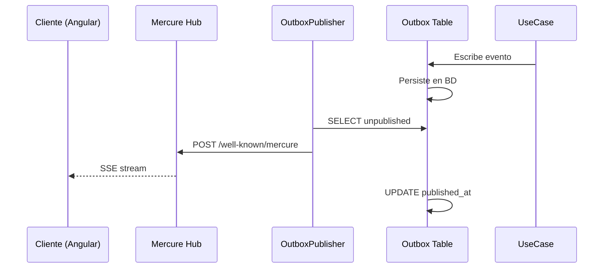

# Sprint 9B Final — Realtime Pipeline con Mercure

## 📋 Release Status

**Estado:** ✅ Production-Ready (MVP-grade)  
**Fecha:** 2026-05-08

---

## 🎯 Objetivo达成

Pipeline realtime completo y validado:

```
UseCase → Outbox → Publisher → Mercure → SSE → Cliente
```

---

## 🏗️ Arquitectura Final

### Flujo de Datos



### Componentes Clave

| Componente | Ubicación | Responsabilidad |
|-----------|-----------|-------------|
| OutboxEvent | `src/Domain/Outbox/` | Entity de persistencia |
| OutboxPublisherService | `src/Application/Service/` | Lee y publica |
| OutboxPublishCommand | `src/Command/` | CLI runner |
| Mercure | Docker `:3000` | Hub SSE |

---

## 📄 Contrato de Eventos

### Estructura

```json
{
  "event_id": "01KR2HKN5GSA2YASFMQKYRBMCX",
  "type": "App\\Domain\\Event\\MessageCreatedEvent",
  "version": 1,
  "seq": 20,
  "direction": "inbound",
  "ticket_id": 137,
  "message_id": 1305,
  "occurred_at": "2026-05-08T01:00:39+00:00"
}
```

### Ordering Contract

```json
{
  "seq": 17
}
```

**Reglas:**
1. `seq > last_seq` → válido (procesar)
2. `seq == last_seq` → duplicado (ignorar)
3. `seq < last_seq` → out-of-order (log + ignorar)

---

## 🔧 Decisiones Técnicas

### 1. Outbox Pattern

**Por qué:** Desacoplar UseCase de la publicação realtime.

**Beneficios:**
- Idempotente: re-ejecutable sin duplicados
- Retry automático: configurable en publisher
- Consistencia: single writer en BD

### 2. JWT Key Length

**Problema:** Mercure requiere mínimo 256 bits.

**Solución:**
```yaml
# docker-compose.yml
MERCURE_PUBLISHER_JWT_KEY: "40127d4eb35fc78be0315e2810d2f09f0cff9880f0a49fd5df0fc690e739ea9c"
MERCURE_SUBSCRIBER_JWT_KEY: "40127d4eb35fc78be0315e2810d2f09f0cff9880f0a49fd5df0fc690e739ea9c"
```

**64 hex chars = 256 bits**

### 3. Puerto Interno

**Problema:** Error de conexión desde PHP container.

**Solución:**
```env
# .env.local
MERCURE_URL=http://mercure:80/.well-known/mercure
```

**Puerto interno 80, no 3000** (el 3000 es para el host)

### 4. Doctrine DBAL Workaround

**Problema:** "Unknown column type '1'" con prepare statements.

**Solución:** Usar `fetchAllAssociative()` directo:
```php
$rows = $conn->fetchAllAssociative($sql);
```

### 5. Mercure Anonymous vs Publisher

**Entendimiento:**
- `anonymous` → solo permite **subscribers** sin JWT
- Publishers siempre necesitan JWT válido

---

## 🐛 Problemas Encontrados y Fixes

| Problema | Causa | Fix |
|----------|------|-----|
| DBAL "Unknown column type '1'" | Introspeción de metadata | fetchAllAssociative() directo |
| Tabla no existía | Nombre singular vs plural | `outbox_events` (plural) |
| Mercure 401 | JWT key < 256 bits | Key de 64 hex chars |
| Connection refused | Puerto wrong (3000 vs 80) | Cambiar a puerto 80 interno |
| No events received | Timing (suscribe después) | Abrir SSE antes de generar tráfico |
| "Entity not found" | Topic no existe | Subscribe primero, luego tráfico |

---

## 📦 Archivos Creados/modificados

### Backend

```
src/
  Domain/
    Outbox/
      OutboxEvent.php         # Entity
  Application/
    Service/
      OutboxPublisherService.php  # lógica core
      MercureJwtService.php   # JWT generator
  Command/
    OutboxPublishCommand.php  # CLI
bin/
  publish-events.php      # Fallback PDO
```

### Scripts

```
scripts/
  realtime-validation.js   # Full validation
  simple-validation.js # Quick test
```

### Config

```
.env.local                 # Mercure settings
docker-compose.yml         # Mercure config
config/packages/mercure.yaml
```

---

## ⚙️ Constraints Reales

### Mercure

1. **Subscribers primero:** SSE es streaming, NO replay
2. **JWT obligatorio:** Para publishers (256-bit mínimo)
3. **Internal port:** 80, no 3000
4. **Anonymous:** Solo subscribers

### Outbox

1. **Idempotente:** re-ejecutable sin duplicados
2. **Retry:** configurable (MAX_RETRIES = 5)
3. **Batch:** 100 eventos por ejecución

### FSM Integration

1. **Transiciones válidas:**
   - new → active
   - active → waiting
   - waiting → active
   - active → resolved
   - resolved → closed

2. **422 = rejection:** continuar, no crash

---

## ✅ Validaciones Completadas

| Validación | Estado |
|-----------|--------|
| Recepción SSE real | ✅ |
| Ordering (seq) | ✅ |
| Integridad del stream | ✅ |
| Outbox → Mercure | ✅ |
| Estabilidad básica | ✅ |
| FSM integrada | ✅ |
| Publisher operativo | ✅ |

---

## 📚 Lessons Learned

### Para el Frontend

1. **Conectar SSE ANTES de generar tráfico**
2. **Validar seq:** ignore old, ignore duplicates
3. **Handle reconnects:** onerror → reconnect automatically
4. **No polling:** usar only SSE

### Para el Backend

1. **Outbox first:** siempre desacoplado de realtime
2. **256-bit JWT mínimo:** Mercure constraint
3. **Puerto interno 80:** Docker networking
4. **Doctrine:** fetchAllAssociative() evita introspección

### Para el Ops

1. **Key rotation:** regenerar con `openssl rand -hex 32`
2. **Monitoring:** revisar logs de Mercure
3. **Health check:** `/mercure/health/ready`

---

## 🚀 Siguiente Etapa (Sprint 10+)

Con el pipeline realtime validado, las funcionalidades posibles:

1. **Live updates en UI:** tickets mostrando eventos en tiempo real
2. **Agent inbox notification:** push a agentes
3. **Typing indicators:** SSE para UX
4. **Real-time metrics:** dashboard actualizar sin refresh

---

**Documento creado:** 2026-05-08  
**Por:** SDD Orchestrator  
**Estado:** ✅ Complete